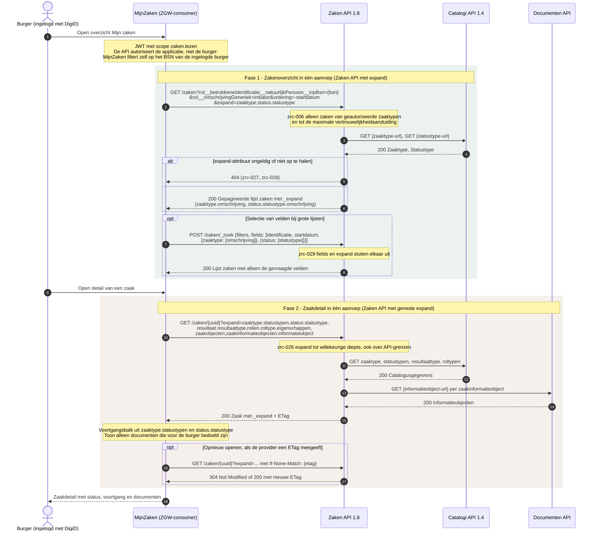
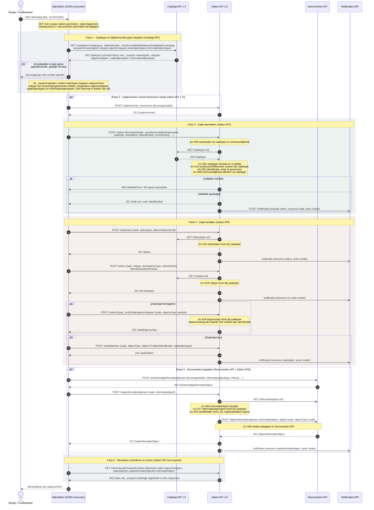
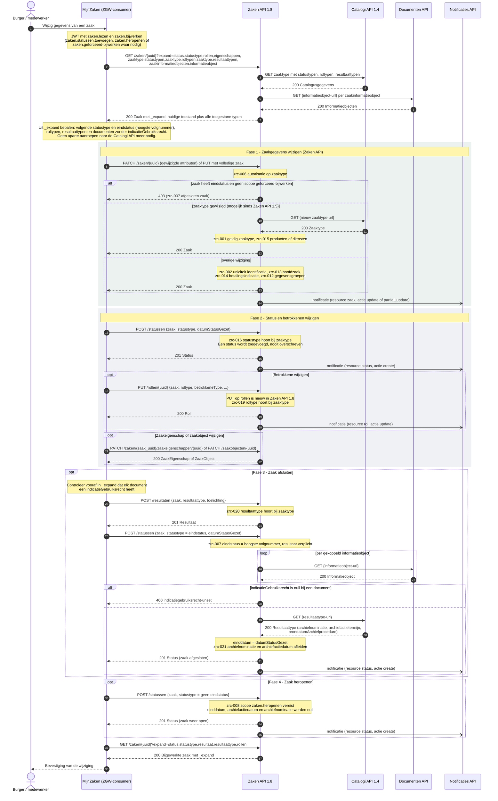
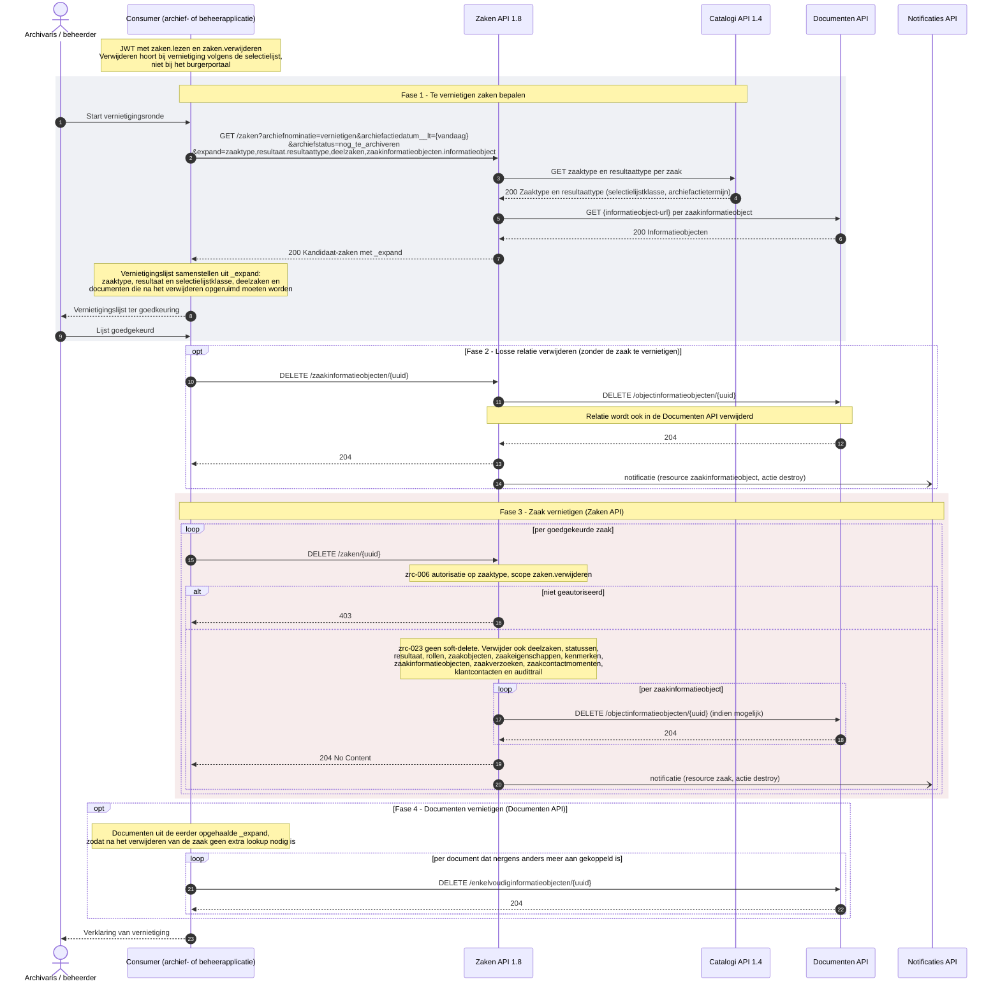

:::info[Werkversie]

Dit aansluitprofiel is een eerste schets. Het profiel helpt onderzoeken hoe
informatie uit de ZGW API's kan worden geïnterpreteerd en vertaald naar het
functionele informatiemodel van MijnZaken.

:::

# Aansluitprofiel ZGW API's

Dit aansluitprofiel beschrijft hoe de ZGW API's als bron worden gebruikt voor de
Interactie API. De uitvoerbare workflows worden vastgelegd in Arazzo:
per operationId van de Interactie API beschrijft een workflow welke ZGW
API-operaties nodig zijn om de response-DTO samen te stellen.

## Positionering

De doelen en scope van MijnZaken worden beschreven bij de
[bouwsteen MijnZaken](../bouwstenen/mijn-zaken/). Deze schets werkt alleen uit
hoe informatie uit de ZGW API's kan worden geïnterpreteerd en vertaald naar
begrippen van MijnZaken, zoals zaak, status, resultaat, document en besluit.

Het aansluitprofiel beschrijft dus wat informatie uit de ZGW API's betekent
binnen MijnServices.

## Bronnen

Dit profiel gaat uit van de ZGW API's als bronfamilie. De precieze combinatie
kan per organisatie verschillen.

| ZGW API        | Rol in dit aansluitprofiel                                       |
| :------------- | :--------------------------------------------------------------- |
| Zaken API      | Bron voor zaken, statussen, zaakrelaties en zaakinformatie.      |
| Catalogi API   | Bron voor zaaktypen, statustypen, resultaattypen en toelichting. |
| Documenten API | Bron voor informatieobjecten en documenten bij een zaak.         |
| Besluiten API  | Bron voor formele besluiten die aan een zaak zijn gekoppeld.     |

De Notificaties API kan relevant zijn voor actualisatie of synchronisatie, maar
is geen primaire bron voor de betekenis van een zaak.

## Mapping naar MijnZaken

De tabel hieronder is bedoeld als koppeltabel. Per regel staat welk begrip in
MijnZaken wordt gevuld, welke ZGW-informatie daarvoor gebruikt kan worden en
welke interpretatie nodig is.

| MijnZaken-begrip         | ZGW-bron                  | Mogelijke ZGW-gegevens                                          | Interpretatie voor MijnZaken                                                                                                                                                               |
| :----------------------- | :------------------------ | :-------------------------------------------------------------- | :----------------------------------------------------------------------------------------------------------------------------------------------------------------------------------------- |
| Zaak                     | Zaken API                 | `Zaak`                                                          | Een zaak vormt het ankerpunt voor de zaakcontext die aan de gebruiker wordt getoond. Niet alle interne zaakgegevens zijn relevant voor weergave.                                           |
| Zaaknummer               | Zaken API                 | `identificatie`                                                 | Wordt gebruikt als herkenbaar referentienummer. De herkomst of betekenis van het nummer kan per organisatie verschillen.                                                                   |
| Zaaktitel                | Zaken API, Catalogi API   | `omschrijving`, `zaaktype`                                      | De titel moet de zaak herkenbaar maken voor de gebruiker. Als de bronomschrijving te intern is, kan een presentatie- of vertaalregel nodig zijn.                                           |
| Zaaktype                 | Catalogi API              | `ZaakType`, `omschrijving`, `productenOfDiensten`               | Het zaaktype helpt zaken groeperen, filteren en herkennen. De functionele naam kan afwijken van de interne catalogusnaam.                                                                  |
| Behandelende organisatie | Zaken API                 | `bronorganisatie`, `verantwoordelijkeOrganisatie`               | Wordt gebruikt om duidelijk te maken welke organisatie de zaak behandelt of verantwoordelijk is voor de informatie.                                                                        |
| Registratiedatum         | Zaken API                 | `registratiedatum`                                              | Geeft aan wanneer de zaak is gestart of geregistreerd. Deze datum is niet altijd hetzelfde als het moment waarop de gebruiker de aanvraag heeft gedaan.                                    |
| Laatste wijziging        | Zaken API of bronmetadata | wijzigingsdatum of auditinformatie                              | ZGW kent niet altijd één duidelijke datum voor laatste wijziging. Per implementatie moet worden bepaald welke datum de actualiteit van de zaak het beste weergeeft.                        |
| Status                   | Zaken API, Catalogi API   | `Status`, `Statustype`, `datumStatusGezet`, `statustoelichting` | De actuele ZGW-status wordt vertaald naar een begrijpelijke status of mijlpaal voor MijnZaken. Interne statustypen kunnen samenkomen in een kleinere set gebruikersgerichte statusgroepen. |
| Statusgeschiedenis       | Zaken API, Catalogi API   | eerdere `Status`-objecten en `Statustype`                       | Wordt gebruikt voor een tijdlijn of voortgangsoverzicht. Niet elke interne status hoeft zichtbaar te zijn voor de gebruiker.                                                               |
| Resultaat                | Zaken API, Catalogi API   | `Resultaat`, `Resultaattype`, `toelichting`                     | Het resultaat maakt duidelijk hoe een afgeronde zaak is geëindigd. De betekenis moet worden vertaald naar begrijpelijke taal.                                                              |
| Einddatum                | Zaken API                 | `einddatum`, `einddatumGepland`, `uiterlijkeEinddatumAfdoening` | Datums moeten worden geduid als feitelijk, gepland, indicatief of wettelijk relevant.                                                                                                      |
| Document                 | Documenten API, Zaken API | `EnkelvoudigInformatieObject`, zaak-informatieobjectrelatie     | Documenten worden getoond in de context van de zaak. Niet ieder informatieobject is geschikt of toegestaan voor weergave aan de gebruiker.                                                 |
| Besluit                  | Besluiten API, Zaken API  | `Besluit`, besluit-zaakrelatie                                  | Een besluit wordt als formele beslissing in de zaakcontext getoond. De relatie met documenten en resultaat moet duidelijk zijn.                                                            |
| Betrokkene               | Zaken API                 | `Rol`, `RolType`                                                | Rollen worden vertaald naar begrijpelijke betrokkenheid, zoals aanvrager, gemachtigde, belanghebbende of behandelaar. Privacy en autorisatie bepalen wat zichtbaar mag zijn.               |
| Bronduiding              | Gebruikte ZGW API's       | API-bron, organisatie, registratiemoment, updategegevens        | MijnZaken moet kunnen uitleggen waar informatie vandaan komt en hoe actueel of formeel deze is.                                                                                            |

## Sequentie diagrammen

Er is een aantal (technische) sequentiediagrammen uitgewerkt voor het aanmaken van een zaak, voor het opvragen van een zaak, voor het bijwerken van een zaak en voor het verwijderen van een zaak. Voor de MijnServices is alleen Opvragen van een zaak van belang.

### Opvragen van een zaak

### Aanmaken van een zaak

### Bijwerken van een zaak

### Verwijderen van een zaak

## Interpretatieregels

Voor ZGW zijn in ieder geval deze regels relevant.

### Statussen vertalen naar gebruikersgerichte mijlpalen

ZGW-statustypen zijn vaak ingericht vanuit het behandelproces van een
organisatie. MijnZaken gebruikt statussen vooral om de gebruiker grip te geven.
Daarom kan een mapping nodig zijn van meerdere interne statustypen naar een
kleinere set begrijpelijke statusgroepen of mijlpalen.

Voorbeeld:

| ZGW-statustype  | MijnZaken-statusgroep | Toelichting                           |
| :-------------- | :-------------------- | :------------------------------------ |
| Ontvangen       | Ontvangen             | De aanvraag of melding is ontvangen.  |
| In behandeling  | In behandeling        | De organisatie werkt aan de zaak.     |
| Besluit genomen | Beslist               | Er is een formele beslissing genomen. |
| Afgehandeld     | Afgerond              | De zaak is afgerond.                  |

### Datums duiden

Datums uit ZGW hebben verschillende betekenissen. MijnZaken moet voorkomen dat
een datum zonder context als harde belofte wordt gelezen.

| Datum                          | Mogelijke betekenis voor MijnZaken             |
| :----------------------------- | :--------------------------------------------- |
| `registratiedatum`             | De zaak is geregistreerd of gestart.           |
| `datumStatusGezet`             | De status is op dit moment ingegaan.           |
| `einddatumGepland`             | Verwachte of geplande afronding.               |
| `uiterlijkeEinddatumAfdoening` | Uiterste afhandeltermijn, wanneer beschikbaar. |
| `einddatum`                    | De zaak is feitelijk afgerond.                 |

### Documenten selecteren voor weergave

Niet elk informatieobject bij een zaak is bedoeld voor de gebruiker. Het profiel
moet daarom vastleggen welke documenttypen of informatieobjecten zichtbaar mogen
zijn, hoe de documentnaam wordt getoond en of een document formeel, ingediend of
ondersteunend is.

### Besluiten verbinden met resultaat

Een besluit en een resultaat zijn niet hetzelfde. Een resultaat geeft aan hoe de
zaak is geëindigd; een besluit is een formele beslissing die daar onderdeel van
kan zijn. MijnZaken moet deze begrippen in samenhang tonen zonder ze te
vermengen.

### Ontbrekende of afgeleide informatie

Niet alle informatie die MijnZaken nodig heeft, is altijd rechtstreeks in ZGW
beschikbaar. Het profiel maakt daarom onderscheid tussen verschillende
modaliteiten.

| Modaliteit               | Betekenis                                                                        |
| :----------------------- | :------------------------------------------------------------------------------- |
| Rechtstreeks beschikbaar | De informatie is direct beschikbaar uit een ZGW-object of relatie.               |
| Afleidbaar               | De informatie kan worden afgeleid uit een combinatie van ZGW-gegevens.           |
| Verrijkt                 | De informatie komt uit ZGW, maar heeft extra tekst, ordening of vertaling nodig. |
| Niet beschikbaar         | De informatie kan met dit aansluitprofiel niet worden geleverd.                  |

## Open vragen

Deze schets laat nog een aantal keuzes open:

- Welke ZGW-statustypen worden per zaaktype vertaald naar welke
  MijnZaken-statusgroepen?
- Welke documenten en informatieobjecten mogen aan de gebruiker worden getoond?
- Wanneer wordt een datum als formeel, indicatief of alleen informatief getoond?
- Welke relatie wordt gelegd tussen zaak, besluit, document en resultaat?
- Welke informatie over betrokkenen is nodig en toegestaan in de zaakcontext?
