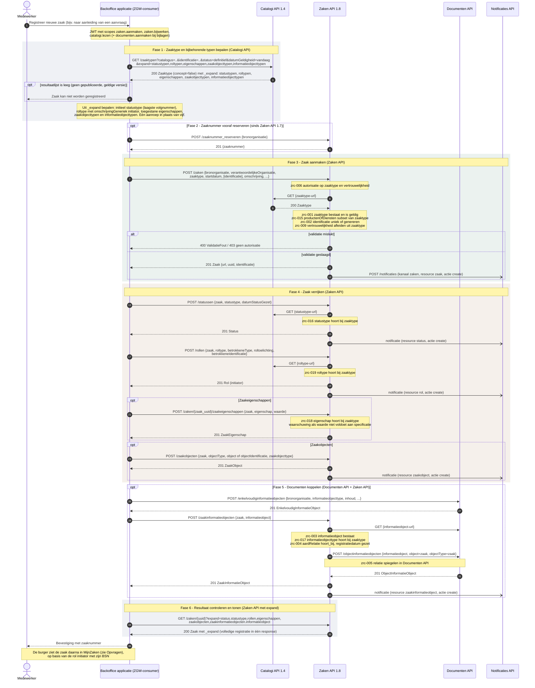
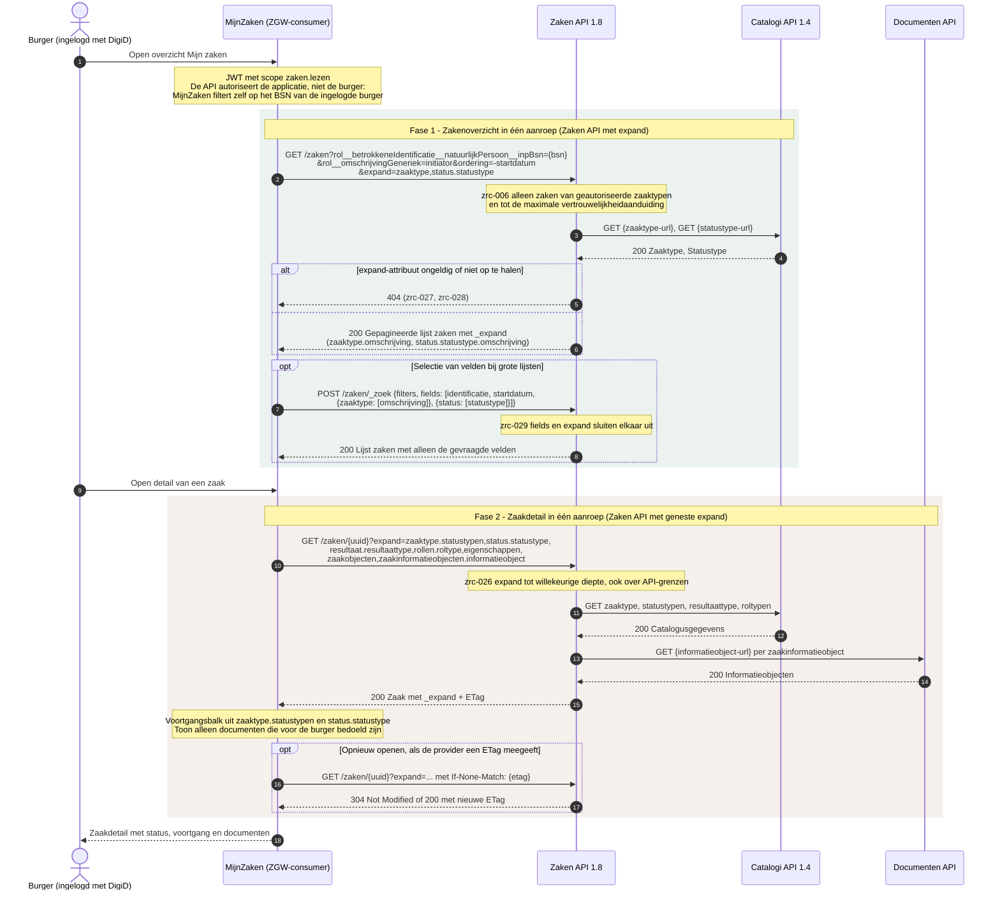
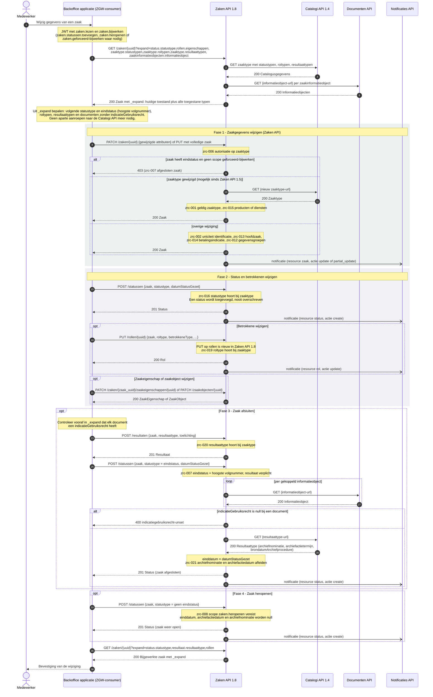
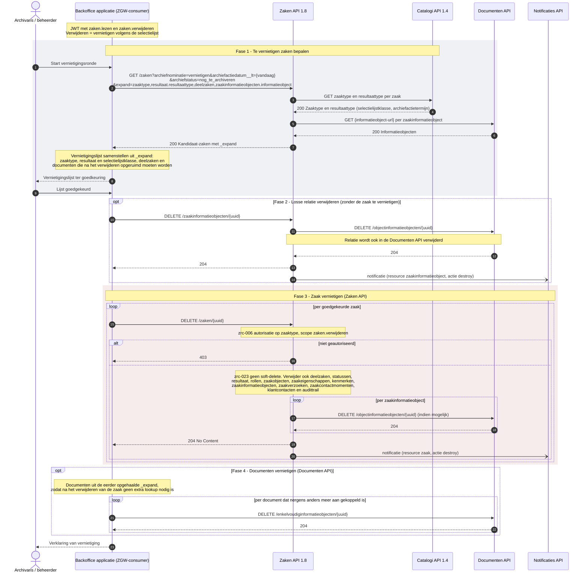

:::info[Werkversie]

Dit aansluitprofiel is een eerste schets. Het profiel helpt onderzoeken hoe
informatie uit de ZGW API's kan worden geïnterpreteerd en vertaald naar het
functionele informatiemodel van MijnZaken.

:::

# Aansluitprofiel ZGW API's

Dit aansluitprofiel beschrijft hoe de ZGW API's als bron worden gebruikt voor de
Interactie API. De uitvoerbare workflows worden vastgelegd in Arazzo:
per operationId van de Interactie API beschrijft een workflow welke ZGW
API-operaties nodig zijn om de response-DTO samen te stellen.

## Positionering

De doelen en scope van MijnZaken worden beschreven bij de
[bouwsteen MijnZaken](../bouwstenen/mijn-zaken/). Deze schets werkt alleen uit
hoe informatie uit de ZGW API's kan worden geïnterpreteerd en vertaald naar
begrippen van MijnZaken, zoals zaak, status, resultaat, document en besluit.

Het aansluitprofiel beschrijft dus wat informatie uit de ZGW API's betekent
binnen MijnServices.

## Bronnen

Dit profiel gaat uit van de ZGW API's als bronfamilie. De precieze combinatie
kan per organisatie verschillen.

| ZGW API        | Rol in dit aansluitprofiel                                       |
| :------------- | :--------------------------------------------------------------- |
| Zaken API      | Bron voor zaken, statussen, zaakrelaties en zaakinformatie.      |
| Catalogi API   | Bron voor zaaktypen, statustypen, resultaattypen en toelichting. |
| Documenten API | Bron voor informatieobjecten en documenten bij een zaak.         |
| Besluiten API  | Bron voor formele besluiten die aan een zaak zijn gekoppeld.     |

De Notificaties API kan relevant zijn voor actualisatie of synchronisatie, maar
is geen primaire bron voor de betekenis van een zaak.

## Mapping naar MijnZaken

De tabel hieronder is bedoeld als koppeltabel. Per regel staat welk begrip in
MijnZaken wordt gevuld, welke ZGW-informatie daarvoor gebruikt kan worden en
welke interpretatie nodig is.

| MijnZaken-begrip         | ZGW-bron                  | Mogelijke ZGW-gegevens                                          | Interpretatie voor MijnZaken                                                                                                                                                               |
| :----------------------- | :------------------------ | :-------------------------------------------------------------- | :----------------------------------------------------------------------------------------------------------------------------------------------------------------------------------------- |
| Zaak                     | Zaken API                 | `Zaak`                                                          | Een zaak vormt het ankerpunt voor de zaakcontext die aan de gebruiker wordt getoond. Niet alle interne zaakgegevens zijn relevant voor weergave.                                           |
| Zaaknummer               | Zaken API                 | `identificatie`                                                 | Wordt gebruikt als herkenbaar referentienummer. De herkomst of betekenis van het nummer kan per organisatie verschillen.                                                                   |
| Zaaktitel                | Zaken API, Catalogi API   | `omschrijving`, `zaaktype`                                      | De titel moet de zaak herkenbaar maken voor de gebruiker. Als de bronomschrijving te intern is, kan een presentatie- of vertaalregel nodig zijn.                                           |
| Zaaktype                 | Catalogi API              | `ZaakType`, `omschrijving`, `productenOfDiensten`               | Het zaaktype helpt zaken groeperen, filteren en herkennen. De functionele naam kan afwijken van de interne catalogusnaam.                                                                  |
| Behandelende organisatie | Zaken API                 | `bronorganisatie`, `verantwoordelijkeOrganisatie`               | Wordt gebruikt om duidelijk te maken welke organisatie de zaak behandelt of verantwoordelijk is voor de informatie.                                                                        |
| Registratiedatum         | Zaken API                 | `registratiedatum`                                              | Geeft aan wanneer de zaak is gestart of geregistreerd. Deze datum is niet altijd hetzelfde als het moment waarop de gebruiker de aanvraag heeft gedaan.                                    |
| Laatste wijziging        | Zaken API of bronmetadata | wijzigingsdatum of auditinformatie                              | ZGW kent niet altijd één duidelijke datum voor laatste wijziging. Per implementatie moet worden bepaald welke datum de actualiteit van de zaak het beste weergeeft.                        |
| Status                   | Zaken API, Catalogi API   | `Status`, `Statustype`, `datumStatusGezet`, `statustoelichting` | De actuele ZGW-status wordt vertaald naar een begrijpelijke status of mijlpaal voor MijnZaken. Interne statustypen kunnen samenkomen in een kleinere set gebruikersgerichte statusgroepen. |
| Statusgeschiedenis       | Zaken API, Catalogi API   | eerdere `Status`-objecten en `Statustype`                       | Wordt gebruikt voor een tijdlijn of voortgangsoverzicht. Niet elke interne status hoeft zichtbaar te zijn voor de gebruiker.                                                               |
| Resultaat                | Zaken API, Catalogi API   | `Resultaat`, `Resultaattype`, `toelichting`                     | Het resultaat maakt duidelijk hoe een afgeronde zaak is geëindigd. De betekenis moet worden vertaald naar begrijpelijke taal.                                                              |
| Einddatum                | Zaken API                 | `einddatum`, `einddatumGepland`, `uiterlijkeEinddatumAfdoening` | Datums moeten worden geduid als feitelijk, gepland, indicatief of wettelijk relevant.                                                                                                      |
| Document                 | Documenten API, Zaken API | `EnkelvoudigInformatieObject`, zaak-informatieobjectrelatie     | Documenten worden getoond in de context van de zaak. Niet ieder informatieobject is geschikt of toegestaan voor weergave aan de gebruiker.                                                 |
| Besluit                  | Besluiten API, Zaken API  | `Besluit`, besluit-zaakrelatie                                  | Een besluit wordt als formele beslissing in de zaakcontext getoond. De relatie met documenten en resultaat moet duidelijk zijn.                                                            |
| Betrokkene               | Zaken API                 | `Rol`, `RolType`                                                | Rollen worden vertaald naar begrijpelijke betrokkenheid, zoals aanvrager, gemachtigde, belanghebbende of behandelaar. Privacy en autorisatie bepalen wat zichtbaar mag zijn.               |
| Bronduiding              | Gebruikte ZGW API's       | API-bron, organisatie, registratiemoment, updategegevens        | MijnZaken moet kunnen uitleggen waar informatie vandaan komt en hoe actueel of formeel deze is.                                                                                            |

# Volgorde van API-aanroepen voor zaken: MijnZaken en backoffice applicatie

Generieke sequence diagrams voor aanmaken, ophalen, bijwerken en verwijderen van een zaak. MijnZaken vraagt zaken alleen op; de backoffice applicatie maakt ze aan, vraagt ze op, wijzigt en verwijdert ze. Leesacties gebruiken waar mogelijk `expand`, zodat gerelateerde gegevens in één aanroep meekomen.

## Zaak aanmaken

Eén `GET /zaaktypen` met `expand` levert het zaaktype met statustypen, roltypen, eigenschappen, zaakobjecttypen en informatieobjecttypen. Daarna registreert de backoffice applicatie de zaak in de Zaken API, die elke referentie zelf opnieuw tegen de Catalogi API valideert. Tot slot haalt de backoffice applicatie de volledige registratie in één aanroep op.

| Nr | Van | Interactie | Beschrijving | Controle | Gevolg |
|---|---|---|---|---|---|
| 1 | Medewerker → Backoffice applicatie | Registreer nieuwe zaak (bijv. naar aanleiding van een aanvraag) | De medewerker registreert een nieuwe zaak, bijvoorbeeld naar aanleiding van een aanvraag. Hij kiest het soort zaak; de backoffice applicatie kent daarbij de catalogus en de zaaktype-identificatie. |  |  |
| 2 | Backoffice applicatie → Catalogi API 1.4 | `GET /zaaktypen?catalogus=..&identificatie=..&status=definitief&datumGeldigheid=vandaag&expand=statustypen,roltypen,eigenschappen,zaakobjecttypen,informatieobjecttypen` | De backoffice applicatie zoekt het zaaktype op met `catalogus`, `identificatie`, `status=definitief` en `datumGeldigheid`. Via `expand` komen de statustypen, roltypen, eigenschappen, zaakobjecttypen en informatieobjecttypen in dezelfde response mee. | Catalogi: alleen zaaktypen met `concept=false` gebruiken, geldig op de startdatum. | Filter `status=definitief` |
| 3 | Catalogi API 1.4 → Backoffice applicatie | 200 Zaaktype (concept=false) met _expand: statustypen, roltypen, eigenschappen, zaakobjecttypen, informatieobjecttypen | De Catalogi API levert de gepubliceerde versie die op die datum geldig is. De backoffice applicatie bepaalt hieruit het initiële statustype (laagste `volgnummer`), het roltype `initiator` en de toegestane eigenschappen, zaakobjecttypen en informatieobjecttypen. |  |  |
| 4 | Backoffice applicatie → Medewerker | Zaak kan niet worden geregistreerd | Alleen als de lijst uit 3 leeg is: er is geen gepubliceerde, geldige versie van het zaaktype. De backoffice applicatie meldt dit en maakt geen zaak aan. | Catalogi: geen geldig zaaktype op de peildatum. | Flow stopt |
| 5 | Backoffice applicatie → Zaken API 1.8 | `POST /zaaknummer_reserveren` `{bronorganisatie}` | Optioneel (sinds Zaken API 1.7). De backoffice applicatie reserveert vooraf een zaaknummer voor de bronorganisatie, bijvoorbeeld voor een ontvangstbevestiging. |  |  |
| 6 | Zaken API 1.8 → Backoffice applicatie | 201 `{zaaknummer}` | De Zaken API geeft het gereserveerde nummer terug; het wordt niet meer automatisch uitgegeven. De backoffice applicatie geeft het in 7 mee als `identificatie`. |  |  |
| 7 | Backoffice applicatie → Zaken API 1.8 | `POST /zaken` `{bronorganisatie, verantwoordelijkeOrganisatie, zaaktype, startdatum, [identificatie], omschrijving, ...}` | De backoffice applicatie registreert de zaak met bronorganisatie, verantwoordelijke organisatie, zaaktype (uit 3), startdatum, omschrijving en eventueel de identificatie uit 6. | zrc-006: de backoffice applicatie is geautoriseerd voor zaaktype en vertrouwelijkheid, scope `zaken.aanmaken`. | 403 |
| 8 | Zaken API 1.8 → Catalogi API 1.4 | `GET {zaaktype-url}` | De Zaken API haalt het zaaktype zelf op en vertrouwt niet op de controle van de backoffice applicatie in fase 1. | zrc-001: zaaktype-URL bestaat en is een geldig zaaktype. | 400 |
| 9 | Catalogi API 1.4 → Zaken API 1.8 | 200 Zaaktype | Met het zaaktype valideert de Zaken API de zaak. | zrc-015: producten of diensten zijn subset van het zaaktype. zrc-002: identificatie uniek binnen bronorganisatie, anders zelf genereren. zrc-009: vertrouwelijkheidaanduiding afleiden uit zaaktype als die ontbreekt. | 400, gegenereerd nummer of afgeleide waarde |
| 10 | Zaken API 1.8 → Backoffice applicatie | 400 ValidatieFout / 403 geen autorisatie | Foutsituatie: validatie mislukt (400) of geen autorisatie (403). Er is geen zaak; fase 4 tot en met 6 vervallen. | Uitkomst van 7 tot en met 9. | Flow stopt |
| 11 | Zaken API 1.8 → Backoffice applicatie | 201 Zaak `{url, uuid, identificatie}` | De zaak is geregistreerd. De backoffice applicatie bewaart `url`, `uuid` en `identificatie` (het zaaknummer). |  |  |
| 12 | Zaken API 1.8 → Notificaties API | `POST /notificaties` (kanaal zaken, resource zaak, actie create) | De Zaken API meldt op kanaal `zaken` dat er een zaak is aangemaakt. De backoffice applicatie wacht hier niet op. |  |  |
| 13 | Backoffice applicatie → Zaken API 1.8 | `POST /statussen` `{zaak, statustype, datumStatusGezet}` | De backoffice applicatie zet de initiële status met het statustype uit 3 en het moment van ontvangst als `datumStatusGezet`. Zonder status ziet de burger in MijnZaken geen voortgang. |  |  |
| 14 | Zaken API 1.8 → Catalogi API 1.4 | `GET {statustype-url}` | De Zaken API haalt het statustype op. | zrc-016: statustype hoort bij het zaaktype. | 400 |
| 15 | Zaken API 1.8 → Backoffice applicatie | 201 Status | De status is vastgelegd. |  |  |
| 16 | Zaken API 1.8 → Notificaties API | notificatie (resource status, actie create) | Abonnees horen dat de zaak een eerste status heeft. |  |  |
| 17 | Backoffice applicatie → Zaken API 1.8 | `POST /rollen` `{zaak, roltype, betrokkeneType, roltoelichting, betrokkeneIdentificatie}` | De backoffice applicatie legt de aanvrager vast als initiator, bij een burger met het BSN uit de aanvraag. Op deze rol filtert MijnZaken later. Vereist `zaken.bijwerken`. | zrc-006: scope `zaken.bijwerken`. | 403 |
| 18 | Zaken API 1.8 → Catalogi API 1.4 | `GET {roltype-url}` | De Zaken API haalt het roltype op. | zrc-019: roltype hoort bij het zaaktype. | 400 |
| 19 | Zaken API 1.8 → Backoffice applicatie | 201 Rol (initiator) | De initiator is vastgelegd. Vanaf nu ziet de burger de zaak in MijnZaken. |  |  |
| 20 | Zaken API 1.8 → Notificaties API | notificatie (resource rol, actie create) | Abonnees horen dat er een betrokkene is toegevoegd. |  |  |
| 21 | Backoffice applicatie → Zaken API 1.8 | `POST /zaken/{zaak_uuid}/zaakeigenschappen` `{zaak, eigenschap, waarde}` | Optioneel, per eigenschap. De backoffice applicatie legt een gegeven uit de aanvraag vast met een eigenschap uit 3. | zrc-018: eigenschap hoort bij het zaaktype. | 400 |
| 22 | Zaken API 1.8 → Backoffice applicatie | 201 ZaakEigenschap | De eigenschap is vastgelegd. | Waarde voldoet aan de specificatie van de eigenschap. | Waarschuwing, waarde wel opgeslagen |
| 23 | Backoffice applicatie → Zaken API 1.8 | `POST /zaakobjecten` `{zaak, objectType, object of objectIdentificatie, zaakobjecttype}` | Optioneel, per object. De backoffice applicatie koppelt een object, zoals een adres of pand, met het zaakobjecttype uit 3. |  |  |
| 24 | Zaken API 1.8 → Backoffice applicatie | 201 ZaakObject | Het object is aan de zaak gekoppeld. |  |  |
| 25 | Zaken API 1.8 → Notificaties API | notificatie (resource zaakobject, actie create) | Abonnees horen dat er een object is gekoppeld. |  |  |
| 26 | Backoffice applicatie → Documenten API | `POST /enkelvoudiginformatieobjecten` `{bronorganisatie, informatieobjecttype, inhoud, ...}` | Optioneel, per bijlage. De backoffice applicatie registreert het document met een informatieobjecttype uit 3. Vereist `documenten.aanmaken`. |  |  |
| 27 | Documenten API → Backoffice applicatie | 201 EnkelvoudigInformatieObject | Het document bestaat, maar hoort nog niet bij de zaak. |  |  |
| 28 | Backoffice applicatie → Zaken API 1.8 | `POST /zaakinformatieobjecten` `{zaak, informatieobject}` | De backoffice applicatie koppelt het document aan de zaak. |  |  |
| 29 | Zaken API 1.8 → Documenten API | `GET {informatieobject-url}` | De Zaken API haalt het document op en controleert het. | zrc-003: informatieobject bestaat. zrc-017: informatieobjecttype hoort bij het zaaktype. zrc-004: relatie is `hoort_bij`, registratiedatum wordt gezet. | 400 |
| 30 | Zaken API 1.8 → Documenten API | `POST /objectinformatieobjecten` `{informatieobject, object=zaak, objectType=zaak}` | De Zaken API legt de relatie ook vast in de Documenten API. De backoffice applicatie hoeft dit niet zelf te doen. | zrc-005: relatie wordt gespiegeld als objectinformatieobject in de Documenten API. | Door de Zaken API |
| 31 | Documenten API → Zaken API 1.8 | 201 ObjectInformatieObject | De relatie staat aan beide kanten. |  |  |
| 32 | Zaken API 1.8 → Backoffice applicatie | 201 ZaakInformatieObject | Het document is aan de zaak gekoppeld. Bij een 400 in 29 bestaat het document wel, maar zonder relatie met de zaak. |  |  |
| 33 | Zaken API 1.8 → Notificaties API | notificatie (resource zaakinformatieobject, actie create) | Abonnees horen dat er een document is gekoppeld. |  |  |
| 34 | Backoffice applicatie → Zaken API 1.8 | `GET /zaken/{uuid}?expand=status.statustype,rollen,eigenschappen,zaakobjecten,zaakinformatieobjecten.informatieobject` | De backoffice applicatie haalt de volledige registratie op met `expand`. | Expand werkt alleen op GET-operaties, niet op POST, PUT of PATCH. | Na een schrijfactie apart ophalen |
| 35 | Zaken API 1.8 → Backoffice applicatie | 200 Zaak met _expand (volledige registratie in één response) | De backoffice applicatie controleert of status, initiator, eigenschappen, objecten en documenten zijn vastgelegd. |  |  |
| 36 | Backoffice applicatie → Medewerker | Bevestiging met zaaknummer | De medewerker krijgt een bevestiging met het zaaknummer. De burger ziet de zaak vanaf dan in MijnZaken. |  |  |

## Zaken ophalen

MijnZaken kan zaken alleen opvragen en bekijken. Overzicht en detail komen elk uit één aanroep op de Zaken API. Met geneste `expand` haalt de Zaken API zelf de catalogusgegevens en de documenten op, ook over API-grenzen heen.

| Nr | Van | Interactie | Beschrijving | Controle | Gevolg |
|---|---|---|---|---|---|
| 1 | Burger → MijnZaken | Open overzicht Mijn zaken | De burger is ingelogd met DigiD en opent het overzicht. MijnZaken neemt het BSN uit de DigiD-sessie over. |  |  |
| 2 | MijnZaken → Zaken API 1.8 | `GET /zaken?rol__betrokkeneIdentificatie__natuurlijkPersoon__inpBsn={bsn}&rol__omschrijvingGeneriek=initiator&ordering=-startdatum&expand=zaaktype,status.statustype` | MijnZaken vraagt de zaken op waarin het BSN voorkomt als `initiator`, nieuwste eerst, met zaaktype en actuele status via `expand`. Het resultaat is gepagineerd. | zrc-006: alleen zaken van geautoriseerde zaaktypen, tot de maximale vertrouwelijkheid. Portaal: de API autoriseert de applicatie, niet de burger. | Zaken vallen weg uit de lijst; MijnZaken filtert zelf op BSN |
| 3 | Zaken API 1.8 → Catalogi API 1.4 | `GET {zaaktype-url}`, `GET {statustype-url}` | Voor de expand haalt de Zaken API zaaktype en statustype op. MijnZaken doet dat niet zelf. | zrc-026: expand mag genest worden, bijvoorbeeld `status.statustype`. | Eén aanroep |
| 4 | Catalogi API 1.4 → Zaken API 1.8 | 200 Zaaktype, Statustype | De Catalogi API levert de typen voor de omschrijving van zaaktype en status. |  |  |
| 5 | Zaken API 1.8 → MijnZaken | 404 (zrc-027, zrc-028) | Foutsituatie. MijnZaken toont een foutmelding in plaats van een onvolledig overzicht. | zrc-027/028: expand-attribuut moet bij de resource horen en ophaalbaar zijn. | 404 |
| 6 | Zaken API 1.8 → MijnZaken | 200 Gepagineerde lijst zaken met _expand (zaaktype.omschrijving, status.statustype.omschrijving) | MijnZaken toont per zaak identificatie, zaaktype, startdatum en actuele status. |  |  |
| 7 | MijnZaken → Zaken API 1.8 | `POST /zaken/_zoek` `{filters, fields: [identificatie, startdatum, {zaaktype: [omschrijving]}, {status: [statustype]}]}` | Optioneel alternatief voor grote lijsten: dezelfde filters in de body en in `fields` alleen de velden die het overzicht toont. | zrc-029: `fields` beperkt de velden en is niet te combineren met `expand`. | Kleinere response |
| 8 | Zaken API 1.8 → MijnZaken | 200 Lijst zaken met alleen de gevraagde velden | Functioneel hetzelfde overzicht als na 6. |  |  |
| 9 | Burger → MijnZaken | Open detail van een zaak | De burger kiest een zaak; MijnZaken gebruikt de `uuid` uit 6 of 8. |  |  |
| 10 | MijnZaken → Zaken API 1.8 | `GET /zaken/{uuid}?expand=zaaktype.statustypen,status.statustype,resultaat.resultaattype,rollen.roltype,eigenschappen,zaakobjecten,zaakinformatieobjecten.informatieobject` | MijnZaken vraagt de zaak op met geneste expand: zaaktype met statustypen, status, resultaat, rollen, eigenschappen, zaakobjecten en documenten. | zrc-006: autorisatie op zaaktype en vertrouwelijkheid. zrc-026: expand tot willekeurige diepte, ook over API-grenzen. | 403 bij geen autorisatie |
| 11 | Zaken API 1.8 → Catalogi API 1.4 | GET zaaktype, statustypen, resultaattype, roltypen | De Zaken API haalt de catalogusgegevens voor de expand op. |  |  |
| 12 | Catalogi API 1.4 → Zaken API 1.8 | 200 Catalogusgegevens | De statustypen bevatten `volgnummer` en `isEindstatus`, nodig voor de voortgangsbalk. |  |  |
| 13 | Zaken API 1.8 → Documenten API | `GET {informatieobject-url}` per zaakinformatieobject | De Zaken API haalt elk gekoppeld document op. |  |  |
| 14 | Documenten API → Zaken API 1.8 | 200 Informatieobjecten | De Documenten API levert titel, bestandsnaam, status en vertrouwelijkheid. |  |  |
| 15 | Zaken API 1.8 → MijnZaken | 200 Zaak met _expand + ETag | MijnZaken controleert dat de burger initiator is, bouwt de voortgangsbalk en toont alleen documenten die voor de burger bedoeld zijn. | Portaal: BSN van de ingelogde burger staat in een rol `initiator`. | Zaak niet tonen |
| 16 | MijnZaken → Zaken API 1.8 | `GET /zaken/{uuid}?expand=...` met If-None-Match: `{etag}` | Optioneel bij opnieuw openen: MijnZaken stuurt de ETag uit 15 mee. | HTTP-caching met `If-None-Match`, als de provider bij expand een ETag geeft. |  |
| 17 | Zaken API 1.8 → MijnZaken | 304 Not Modified of 200 met nieuwe ETag | Bij 304 toont MijnZaken de eerder opgehaalde gegevens; bij 200 verwerkt het de nieuwe zoals bij 15. |  | 304 Not Modified |
| 18 | MijnZaken → Burger | Zaakdetail met status, voortgang en documenten | De burger ziet zaaktype, actuele status, voortgang, resultaat (bij een afgesloten zaak), betrokkenen en zijn documenten. |  |  |

## Zaak bijwerken

Alleen de backoffice applicatie wijzigt zaken. Eén `GET /zaken/{uuid}` met `expand` levert de huidige toestand én alle toegestane statustypen, roltypen en resultaattypen. Daarna volgen de schrijfacties. Een statuswijziging is een nieuwe status, en afsluiten vraagt eerst een resultaat en dan de eindstatus.

| Nr | Van | Interactie | Beschrijving | Controle | Gevolg |
|---|---|---|---|---|---|
| 1 | Medewerker → Backoffice applicatie | Wijzig gegevens van een zaak | De medewerker wil gegevens, status, betrokkenen of eigenschappen van een zaak wijzigen, of de zaak afsluiten of heropenen. |  |  |
| 2 | Backoffice applicatie → Zaken API 1.8 | `GET /zaken/{uuid}?expand=status.statustype,rollen,eigenschappen,zaaktype.statustypen,zaaktype.roltypen,zaaktype.resultaattypen,zaakinformatieobjecten.informatieobject` | De backoffice applicatie haalt de huidige toestand op, met via expand ook alle toegestane statustypen, roltypen en resultaattypen van het zaaktype en de gekoppelde documenten. |  |  |
| 3 | Zaken API 1.8 → Catalogi API 1.4 | GET zaaktype met statustypen, roltypen, resultaattypen | De Zaken API haalt de catalogusgegevens voor de expand op. |  |  |
| 4 | Catalogi API 1.4 → Zaken API 1.8 | 200 Catalogusgegevens | De Catalogi API levert zaaktype, statustypen, roltypen en resultaattypen. |  |  |
| 5 | Zaken API 1.8 → Documenten API | `GET {informatieobject-url}` per zaakinformatieobject | De Zaken API haalt elk gekoppeld document op. |  |  |
| 6 | Documenten API → Zaken API 1.8 | 200 Informatieobjecten | De Documenten API levert de documenten, met `indicatieGebruiksrecht`. |  |  |
| 7 | Zaken API 1.8 → Backoffice applicatie | 200 Zaak met _expand: huidige toestand plus alle toegestane typen | De backoffice applicatie bepaalt hieruit het volgende statustype, de eindstatus (hoogste volgnummer), de roltypen, de resultaattypen en documenten zonder indicatie gebruiksrecht. Er zijn geen losse aanroepen op de Catalogi API nodig. |  |  |
| 8 | Backoffice applicatie → Zaken API 1.8 | `PATCH /zaken/{uuid}` `{gewijzigde attributen}` of PUT met volledige zaak | De backoffice applicatie wijzigt zaakgegevens met `PATCH` (alleen gewijzigde attributen) of `PUT` (volledige zaak). | zrc-006: autorisatie op zaaktype, scope `zaken.bijwerken`. zrc-022: archiefstatus anders dan `nog_te_archiveren` vereist gearchiveerde documenten en archiefgegevens. | 403 of 400 |
| 9 | Zaken API 1.8 → Backoffice applicatie | 403 (zrc-007 afgesloten zaak) | De zaak is afgesloten en de backoffice applicatie heeft niet de scope om een afgesloten zaak te wijzigen. | zrc-007: afgesloten zaak alleen wijzigen met `zaken.geforceerd-bijwerken`. | 403 |
| 10 | Zaken API 1.8 → Catalogi API 1.4 | `GET {nieuw zaaktype-url}` | Alleen als het zaaktype wijzigt (mogelijk sinds Zaken API 1.5): de Zaken API haalt het nieuwe zaaktype op. | zrc-001: het nieuwe zaaktype bestaat en is geldig. | 400 |
| 11 | Catalogi API 1.4 → Zaken API 1.8 | 200 Zaaktype | De Catalogi API levert het nieuwe zaaktype. | zrc-015: producten of diensten horen bij het nieuwe zaaktype. | 400 |
| 12 | Zaken API 1.8 → Backoffice applicatie | 200 Zaak | De zaak is gewijzigd en valt onder het nieuwe zaaktype. |  |  |
| 13 | Zaken API 1.8 → Backoffice applicatie | 200 Zaak | Bij een andere wijziging dan het zaaktype: de zaak is gewijzigd. | zrc-002: identificatie blijft uniek. zrc-013: geen deelzaak van een deelzaak. zrc-014: geen laatste betaaldatum bij betalingsindicatie nvt. | 400 |
| 14 | Zaken API 1.8 → Notificaties API | notificatie (resource zaak, actie update of partial_update) | Abonnees horen dat de zaak gewijzigd is (actie `update` of `partial_update`). |  |  |
| 15 | Backoffice applicatie → Zaken API 1.8 | `POST /statussen` `{zaak, statustype, datumStatusGezet}` | De backoffice applicatie zet een nieuwe status met een statustype uit 7. Een status wordt toegevoegd, nooit overschreven. | zrc-016: statustype hoort bij het zaaktype. | 400 |
| 16 | Zaken API 1.8 → Backoffice applicatie | 201 Status | De nieuwe status is vastgelegd. |  |  |
| 17 | Zaken API 1.8 → Notificaties API | notificatie (resource status, actie create) | Abonnees horen dat de status is gewijzigd. |  |  |
| 18 | Backoffice applicatie → Zaken API 1.8 | `PUT /rollen/{uuid}` `{zaak, roltype, betrokkeneType, ...}` | Optioneel. De backoffice applicatie vervangt een betrokkene met `PUT /rollen/{uuid}`, nieuw in Zaken API 1.8. | zrc-019: roltype hoort bij het zaaktype. | 400 |
| 19 | Zaken API 1.8 → Backoffice applicatie | 200 Rol | De rol is vervangen. |  |  |
| 20 | Zaken API 1.8 → Notificaties API | notificatie (resource rol, actie update) | Abonnees horen dat de betrokkene is gewijzigd. |  |  |
| 21 | Backoffice applicatie → Zaken API 1.8 | `PATCH /zaken/{zaak_uuid}/zaakeigenschappen/{uuid}` of `PATCH /zaakobjecten/{uuid}` | Optioneel. De backoffice applicatie wijzigt een zaakeigenschap of zaakobject. |  |  |
| 22 | Zaken API 1.8 → Backoffice applicatie | 200 ZaakEigenschap of ZaakObject | De eigenschap of het object is gewijzigd. |  |  |
| 23 | Backoffice applicatie → Zaken API 1.8 | `POST /resultaten` `{zaak, resultaattype, toelichting}` | Afsluiten, stap 1. De backoffice applicatie heeft in 7 gecontroleerd dat elk document een `indicatieGebruiksrecht` heeft, en legt het resultaat vast met een resultaattype uit 7. | zrc-020: resultaattype hoort bij het zaaktype. | 400 |
| 24 | Zaken API 1.8 → Backoffice applicatie | 201 Resultaat | Het resultaat is vastgelegd. |  |  |
| 25 | Backoffice applicatie → Zaken API 1.8 | `POST /statussen` `{zaak, statustype = eindstatus, datumStatusGezet}` | Afsluiten, stap 2. De backoffice applicatie zet de eindstatus. | zrc-007: eindstatus vereist een resultaat. | 400 |
| 26 | Zaken API 1.8 → Documenten API | `GET {informatieobject-url}` | De Zaken API haalt elk gekoppeld document op. |  |  |
| 27 | Documenten API → Zaken API 1.8 | 200 Informatieobject | De Documenten API levert de documenten. | zrc-007: `indicatieGebruiksrecht` is bij elk document gevuld. |  |
| 28 | Zaken API 1.8 → Backoffice applicatie | 400 indicatiegebruiksrecht-unset | Foutsituatie: een document heeft geen indicatie gebruiksrecht. De zaak blijft open. |  | 400 `indicatiegebruiksrecht-unset` |
| 29 | Zaken API 1.8 → Catalogi API 1.4 | `GET {resultaattype-url}` | De Zaken API haalt het resultaattype op. |  |  |
| 30 | Catalogi API 1.4 → Zaken API 1.8 | 200 Resultaattype (archiefnominatie, archiefactietermijn, brondatumArchiefprocedure) | Het resultaattype levert archiefnominatie, archiefactietermijn en brondatum archiefprocedure. |  |  |
| 31 | Zaken API 1.8 → Backoffice applicatie | 201 Status (zaak afgesloten) | De zaak is afgesloten: de einddatum is de datum van de eindstatus. | zrc-021: archiefnominatie en archiefactiedatum afleiden uit het resultaattype. | Waarden gezet bij afsluiten |
| 32 | Zaken API 1.8 → Notificaties API | notificatie (resource status, actie create) | Abonnees horen dat de zaak de eindstatus heeft. |  |  |
| 33 | Backoffice applicatie → Zaken API 1.8 | `POST /statussen` `{zaak, statustype = geen eindstatus}` | Optioneel. De backoffice applicatie heropent een afgesloten zaak met een status die geen eindstatus is. | zrc-008: heropenen vereist `zaken.heropenen`. | 403 |
| 34 | Zaken API 1.8 → Backoffice applicatie | 201 Status (zaak weer open) | De zaak is weer open. | zrc-008: einddatum, archiefactiedatum en archiefnominatie worden leeggemaakt. | Velden op null |
| 35 | Zaken API 1.8 → Notificaties API | notificatie (resource status, actie create) | Abonnees horen dat de zaak een nieuwe status heeft. |  |  |
| 36 | Backoffice applicatie → Zaken API 1.8 | `GET /zaken/{uuid}?expand=status.statustype,resultaat.resultaattype,rollen` | De backoffice applicatie haalt de bijgewerkte zaak op met `expand`. | Expand werkt alleen op GET-operaties, niet op POST, PUT of PATCH. | Na een schrijfactie apart ophalen |
| 37 | Zaken API 1.8 → Backoffice applicatie | 200 Bijgewerkte zaak met _expand | De backoffice applicatie heeft de nieuwe toestand van de zaak. |  |  |
| 38 | Backoffice applicatie → Medewerker | Bevestiging van de wijziging | De medewerker krijgt een bevestiging van de wijziging. |  |  |

## Zaak verwijderen

Verwijderen is vernietigen volgens de selectielijst en gebeurt in de backoffice applicatie, nooit in MijnZaken. Eén lijstaanroep met `expand` levert per kandidaat het resultaattype, de deelzaken en de documenten voor de vernietigingslijst.

| Nr | Van | Interactie | Beschrijving | Controle | Gevolg |
|---|---|---|---|---|---|
| 1 | Archivaris / beheerder → Backoffice applicatie | Start vernietigingsronde | De archivaris of beheerder start een vernietigingsronde in de backoffice applicatie. |  |  |
| 2 | Backoffice applicatie → Zaken API 1.8 | `GET /zaken?archiefnominatie=vernietigen&archiefactiedatum__lt={vandaag}&archiefstatus=nog_te_archiveren&expand=zaaktype,resultaat.resultaattype,deelzaken,zaakinformatieobjecten.informatieobject` | De backoffice applicatie zoekt zaken met archiefnominatie `vernietigen`, een verstreken archiefactiedatum en archiefstatus `nog_te_archiveren`, met via expand zaaktype, resultaattype, deelzaken en documenten. |  |  |
| 3 | Zaken API 1.8 → Catalogi API 1.4 | GET zaaktype en resultaattype per zaak | De Zaken API haalt per zaak zaaktype en resultaattype op. |  |  |
| 4 | Catalogi API 1.4 → Zaken API 1.8 | 200 Zaaktype en resultaattype (selectielijstklasse, archiefactietermijn) | De Catalogi API levert onder meer de selectielijstklasse en de archiefactietermijn. |  |  |
| 5 | Zaken API 1.8 → Documenten API | `GET {informatieobject-url}` per zaakinformatieobject | De Zaken API haalt elk gekoppeld document op. |  |  |
| 6 | Documenten API → Zaken API 1.8 | 200 Informatieobjecten | De Documenten API levert de documenten. |  |  |
| 7 | Zaken API 1.8 → Backoffice applicatie | 200 Kandidaat-zaken met _expand | De backoffice applicatie stelt de vernietigingslijst samen: per zaak het zaaktype, het resultaat met selectielijstklasse, de deelzaken en de documenten. |  |  |
| 8 | Backoffice applicatie → Archivaris / beheerder | Vernietigingslijst ter goedkeuring | De archivaris of beheerder krijgt de lijst ter goedkeuring. |  |  |
| 9 | Archivaris / beheerder → Backoffice applicatie | Lijst goedgekeurd | De lijst is goedgekeurd; alleen deze zaken worden vernietigd. |  |  |
| 10 | Backoffice applicatie → Zaken API 1.8 | `DELETE /zaakinformatieobjecten/{uuid}` | Optioneel. De backoffice applicatie verwijdert alleen de koppeling tussen een document en een zaak, zonder de zaak te vernietigen. |  |  |
| 11 | Zaken API 1.8 → Documenten API | `DELETE /objectinformatieobjecten/{uuid}` | De Zaken API verwijdert de relatie ook in de Documenten API. |  |  |
| 12 | Documenten API → Zaken API 1.8 | 204 | De relatie is in de Documenten API verwijderd. |  |  |
| 13 | Zaken API 1.8 → Backoffice applicatie | 204 | De koppeling is verwijderd; zaak en document bestaan nog. |  | 204 |
| 14 | Zaken API 1.8 → Notificaties API | notificatie (resource zaakinformatieobject, actie destroy) | Abonnees horen dat de koppeling is verwijderd. |  |  |
| 15 | Backoffice applicatie → Zaken API 1.8 | `DELETE /zaken/{uuid}` | Per goedgekeurde zaak verwijdert de backoffice applicatie de zaak. | zrc-006: scope `zaken.verwijderen` voor het zaaktype van de zaak. | 403 |
| 16 | Zaken API 1.8 → Backoffice applicatie | 403 | Foutsituatie: de backoffice applicatie is niet geautoriseerd. De zaak blijft bestaan. |  | 403 |
| 17 | Zaken API 1.8 → Documenten API | `DELETE /objectinformatieobjecten/{uuid}` (indien mogelijk) | De Zaken API verwijdert per document de relatie in de Documenten API. | zrc-023: objectinformatieobject in de Documenten API wordt verwijderd indien mogelijk. | Door de Zaken API |
| 18 | Documenten API → Zaken API 1.8 | 204 | De relatie is verwijderd. |  |  |
| 19 | Zaken API 1.8 → Backoffice applicatie | 204 No Content | De zaak is vernietigd, met alle gerelateerde gegevens. | zrc-023: geen soft-delete; deelzaken, statussen, resultaat, rollen, zaakobjecten, zaakeigenschappen, zaakinformatieobjecten en de audittrail gaan mee. | 204 |
| 20 | Zaken API 1.8 → Notificaties API | notificatie (resource zaak, actie destroy) | Abonnees horen dat de zaak is vernietigd. |  |  |
| 21 | Backoffice applicatie → Documenten API | `DELETE /enkelvoudiginformatieobjecten/{uuid}` | Per document dat nergens meer aan gekoppeld is, vernietigt de backoffice applicatie het document. De documenten komen uit de lijst van 7. | Documenten: de backoffice applicatie verwijdert documenten zelf in de Documenten API. | Aparte stap |
| 22 | Documenten API → Backoffice applicatie | 204 | Het document is vernietigd. |  | 204 |
| 23 | Backoffice applicatie → Archivaris / beheerder | Verklaring van vernietiging | De archivaris of beheerder krijgt de verklaring van vernietiging. |  |  |

## Interpretatieregels

Voor ZGW zijn in ieder geval deze regels relevant.

### Statussen vertalen naar gebruikersgerichte mijlpalen

ZGW-statustypen zijn vaak ingericht vanuit het behandelproces van een
organisatie. MijnZaken gebruikt statussen vooral om de gebruiker grip te geven.
Daarom kan een mapping nodig zijn van meerdere interne statustypen naar een
kleinere set begrijpelijke statusgroepen of mijlpalen.

Voorbeeld:

| ZGW-statustype  | MijnZaken-statusgroep | Toelichting                           |
| :-------------- | :-------------------- | :------------------------------------ |
| Ontvangen       | Ontvangen             | De aanvraag of melding is ontvangen.  |
| In behandeling  | In behandeling        | De organisatie werkt aan de zaak.     |
| Besluit genomen | Beslist               | Er is een formele beslissing genomen. |
| Afgehandeld     | Afgerond              | De zaak is afgerond.                  |

### Datums duiden

Datums uit ZGW hebben verschillende betekenissen. MijnZaken moet voorkomen dat
een datum zonder context als harde belofte wordt gelezen.

| Datum                          | Mogelijke betekenis voor MijnZaken             |
| :----------------------------- | :--------------------------------------------- |
| `registratiedatum`             | De zaak is geregistreerd.           |
| `datumStatusGezet`             | De status is op dit moment afgerond.           |
| `einddatumGepland`             | Verwachte of geplande afronding.               |
| `uiterlijkeEinddatumAfdoening` | Uiterste afhandeltermijn, wanneer beschikbaar. |
| `einddatum`                    | De zaak is feitelijk afgerond.                 |

### Documenten selecteren voor weergave

Niet elk informatieobject bij een zaak is bedoeld voor de gebruiker. Het profiel
moet daarom vastleggen welke documenttypen of informatieobjecten zichtbaar mogen
zijn, hoe de documentnaam wordt getoond en of een document formeel, ingediend of
ondersteunend is.

### Besluiten verbinden met resultaat

Een besluit en een resultaat zijn niet hetzelfde. Een resultaat geeft aan hoe de
zaak is geëindigd; een besluit is een formele beslissing die daar onderdeel van
kan zijn. MijnZaken moet deze begrippen in samenhang tonen zonder ze te
vermengen.

### Ontbrekende of afgeleide informatie

Niet alle informatie die MijnZaken nodig heeft, is altijd rechtstreeks in ZGW
beschikbaar. Het profiel maakt daarom onderscheid tussen verschillende
modaliteiten.

| Modaliteit               | Betekenis                                                                        |
| :----------------------- | :------------------------------------------------------------------------------- |
| Rechtstreeks beschikbaar | De informatie is direct beschikbaar uit een ZGW-object of relatie.               |
| Afleidbaar               | De informatie kan worden afgeleid uit een combinatie van ZGW-gegevens.           |
| Verrijkt                 | De informatie komt uit ZGW, maar heeft extra tekst, ordening of vertaling nodig. |
| Niet beschikbaar         | De informatie kan met dit aansluitprofiel niet worden geleverd.                  |

## Open vragen

Deze schets laat nog een aantal keuzes open:

- Welke ZGW-statustypen worden per zaaktype vertaald naar welke
  MijnZaken-statusgroepen?
- Welke documenten en informatieobjecten mogen aan de gebruiker worden getoond?
- Wanneer wordt een datum als formeel, indicatief of alleen informatief getoond?
- Welke relatie wordt gelegd tussen zaak, besluit, document en resultaat?
- Welke informatie over betrokkenen is nodig en toegestaan in de zaakcontext?
