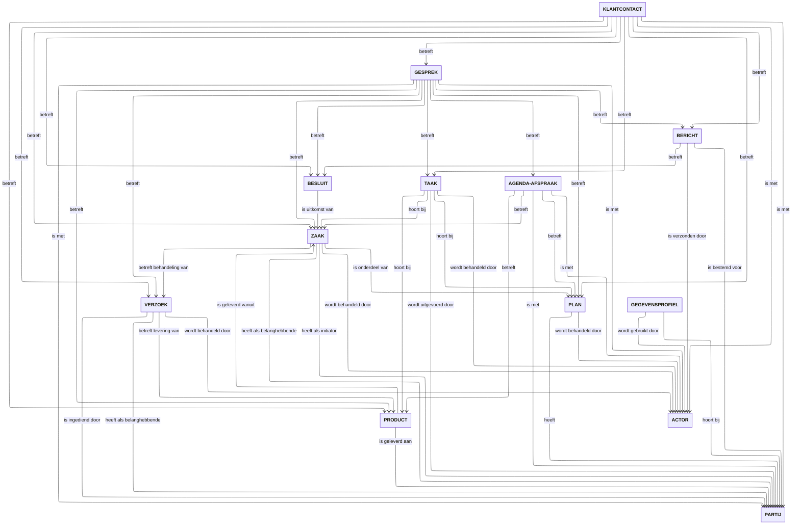

import Link from "@docusaurus/Link";
import useBaseUrl from "@docusaurus/useBaseUrl";
import {
  useCurrentSidebarSiblings,
  filterDocCardListItems,
  useDocById,
} from "@docusaurus/plugin-content-docs/client";
import styles from "@site/src/theme/DocCard/styles.module.css";

export const BouwsteenCard = ({ item }) => {
  const doc = useDocById(item.docId ?? undefined);
  const description = item.description ?? doc?.description;
  const iconUrl = useBaseUrl(item.customProps?.icon);
  return (
    <article
      className="col col--6"
      style={{ marginBottom: "var(--ifm-spacing-vertical)" }}
    >
      <Link
        href={item.href}
        className={`card padding--lg ${styles.cardContainer}`}
      >
        <h3 className={styles.cardTitle}>
          {item.customProps?.icon && (
            
          )}{" "}
          {item.label}
        </h3>
        {description && 
{description}
}
      </Link>
    </article>
  );
};

export const BouwsteenCardList = () => (
  <section className="row">
    {filterDocCardListItems(useCurrentSidebarSiblings()).map((item, i) => (
      <BouwsteenCard key={i} item={item} />
    ))}
  </section>
);

# Bouwstenen

Een bouwsteen binnen MijnServices beschrijft een herkenbaar onderdeel van publieke
dienstverlening vanuit het perspectief van de inwoner of ondernemer. Elke bouwsteen
bevat het bijbehorende interactiepatroon (hoe de interactie verloopt en welke handelingen
mogelijk zijn) én het functionele informatiemodel (welke begrippen, statussen en gegevens
betekenisvol zijn).

## Kernmodel begrippen
Elke bouwsteen is opgebouwd uit een aantal begrippen en bevat één kernbegrip. De kernbegrippen zijn ook onderling met elkaar verbonden en worden in onderstaand kernmodel van begrippen in relatiegebracht.

Vanuit de bouwsteen wordt de uitwerking verder geconcretiseerd in kanalen (zoals
schermprofielen in de mijnomgeving), de Interactie API en aansluitprofielen naar
bronsystemen.

Hieronder vindt u het overzicht van de bouwstenen die in deze documentatie zijn
uitgewerkt.

<BouwsteenCardList />
