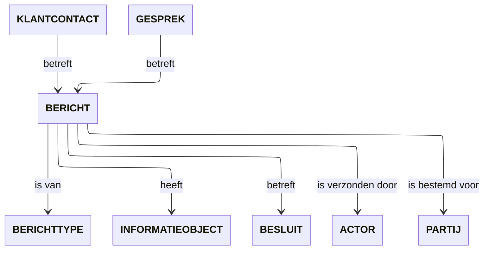

# MijnBerichten

MijnBerichten biedt de mogelijkheid om informatieve berichten of meldingen te
versturen aan inwoners en ondernemers. Bijvoorbeeld over een taak die nog
uitgevoerd moet worden of over een genomen besluit. Dit werkt hetzelfde als de
berichtenbox van MijnOverheid.

## Begrippenkader
Onderstaand model toont de onderlinge relaties tussen de verschillende begrippen. Daaronder zijn in de tabel de definities van de begrippen opgenomen.

&nbsp;
| Begrip | Definitie |
| --- | --- |
| **ACTOR** |	Iets dat of iemand die voor de overheidsorganisatie werkzaamheden uitvoert. |
| **BERICHT** |	Digitale post dat een overheidsorganisatie naar een burger, bedrijf of instelling stuurt, waarin informatie en/of documenten worden aangeboden die de burger, het bedrijf of de instelling in de persoonlijke digitale postbus ontvangt. |
| **BERICHTTYPE** |	Specificatie van vast te leggen informatie over een BERICHT. |
| **BESLUIT** |	Een schriftelijke beslissing van een bestuursorgaan, inhoudende een publiekrechtelijke rechtshandeling. |
| **GESPREK** |	Een digitale dialoog tussen een burger, bedrijf of instelling en (een) overheidsorganisatie(s). |
| **INFORMATIEOBJECT** |	Een INFORMATIEOBJECT waarvan aard, omvang en/of vorm aanleiding geven het als één geheel te behandelen en te beheren. |
| **KLANTCONTACT** |	Contactmoment tussen een burger, bedrijf of instelling en een overheidsorganisatie dat werkelijk heeft plaatsgevonden. |
| **PARTIJ** |	Persoon of organisatie waarmee de overheidsorganisatie een relatie heeft. |
