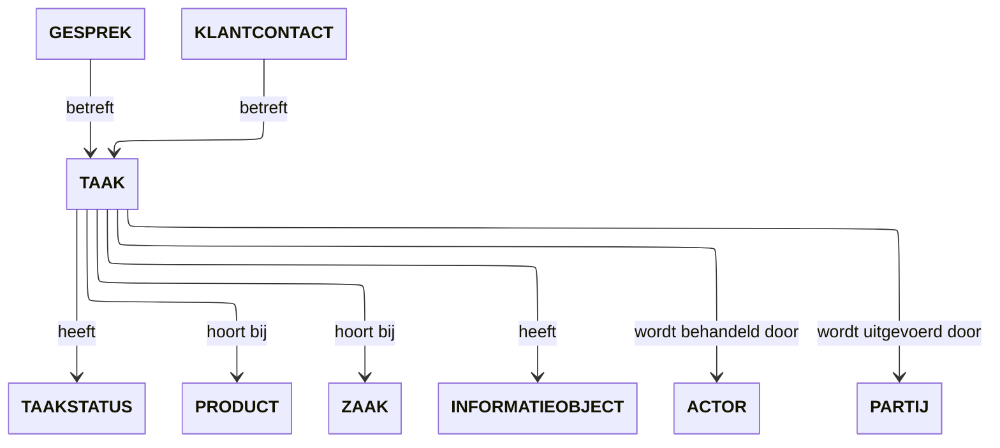

# MijnTaken

MijnTaken brengt handelingsperspectief in overheidsdienstverlening. De bouwsteen helpt inwoners en ondernemers begrijpen wat er nog moet gebeuren om verder te kunnen, waarom een handeling nodig is en hoe ze die met zekerheid afronden — zoals een ontbrekend document aanleveren, een formulier invullen of leges betalen.

## Doel en gebruikersbehoeften

Een inwoner of ondernemer wil iets voor elkaar krijgen in het dagelijks leven of bedrijf (een vergunning, voorziening, subsidie of melding). Een verzoek van de overheid is daarin slechts een noodzakelijke tussenstap. MijnTaken ondersteunt het interactiemoment waarin de overheid actie van de gebruiker vraagt.

Duidelijkheid over wat er moet gebeuren en een tijdige bevestiging na afloop nemen onzekerheid weg en voorkomen vertraging in de behandeling.

| Vraag van de gebruiker                              | Wat MijnTaken ondersteunt                                                                  |
| :-------------------------------------------------- | :----------------------------------------------------------------------------------------- |
| **Moet ik zelf nog iets doen om verder te kunnen?** | Geeft overzicht van openstaande acties en signaleert wat direct aandacht vraagt.           |
| **Wat wordt er van mij gevraagd, en waarom?**       | Biedt een begrijpelijke toelichting in de context van de lopende aanvraag of dienst.       |
| **Voor wanneer moet ik reageren?**                  | Maakt termijnen inzichtelijk en legt uit wat de consequentie is van niet tijdig handelen.  |
| **Hoe en waar kan ik dit regelen?**                 | Biedt een passende en veilige manier om de handeling direct uit te voeren of te vervolgen. |
| **Is het goed aangekomen en wat gebeurt er nu?**    | Geeft direct bevestiging en toont een actuele, betrouwbare status van de handeling.        |

## Scope en samenhang

MijnTaken beschrijft de interactie rond het begrijpen, opstarten en voltooien van handelingen die de inwoner of ondernemer zelf moet of kan uitvoeren.

### Afbakening

MijnTaken richt zich zuiver op de actie van de gebruiker. Andere bouwstenen vullen dit aan:

- **MijnTaken** faciliteert de actie (begrijpen wat nodig is, uitvoeren en bevestiging krijgen).
- De context waarbinnen de taak ontstaat (zoals een aanvraag, dossier of besluit) wordt beheerd door [MijnZaken](../mijn-zaken/index.md).
- Vragen over een verzoek lopen via [MijnGesprekken](../mijn-gesprekken/index.md).
- Attenderingen en formele notificaties lopen via [MijnBerichten](../mijn-berichten/index.md).
- Interne werkinstructies en taken voor ambtenaren vallen buiten deze bouwsteen; MijnTaken gaat uitsluitend over handelingen van de burger of ondernemer.

### Combineren in de weergave (composability)

Een openstaande taak staat zelden op zichzelf. In een portaal of app wordt MijnTaken vaak ingebed in de context van andere bouwstenen: bijvoorbeeld een actieknop "Ontbrekend document aanleveren" direct geplaatst in de tijdlijn van een lopende vergunningaanvraag (MijnZaken).

## Begrippenkader

Onderstaand model toont de onderlinge relaties tussen de verschillende begrippen. Daaronder zijn in de tabel de definities van de begrippen opgenomen.

&nbsp;

| Begrip | Definitie |
| --- | --- |
| **ACTOR** | Iets dat of iemand die voor de overheidsorganisatie werkzaamheden uitvoert. |
| **GESPREK** | Een digitale dialoog tussen een burger, bedrijf of instelling en (een) overheidsorganisatie(s). |
| **INFORMATIEOBJECT** | Een INFORMATIEOBJECT waarvan aard, omvang en/of vorm aanleiding geven het als één geheel te behandelen en te beheren. |
| **KLANTCONTACT** | Contactmoment tussen een burger, bedrijf of instelling en een overheidsorganisatie dat werkelijk heeft plaatsgevonden. |
| **PARTIJ** | Persoon of organisatie waarmee de overheidsorganisatie een relatie heeft. |
| **PRODUCT** | Iets wat wordt voortgebracht en een concrete of herkenbare waarde heeft voor een burger, bedrijf, instelling of andere overheidsorganisatie. |
| **TAAK** | Een welomschreven en afgebakende hoeveelheid werk dat iemand doet of moet doen, horende bij een ZAAK of betrekking hebbende op een PRODUCT. |
| **TAAKSTATUS** | Een aanduiding van de stand van zaken van een TAAK op basis van betekenisvol behaald resultaat voor de initiator van de TAAK. |
| **ZAAK** | Een samenhangende hoeveelheid werk met een welgedefinieerde aanleiding en een welgedefinieerd eindresultaat, waarvan kwaliteit en doorlooptijd bewaakt moeten worden. |

## Use cases

### UC-TKN-01: Taken raadplegen

**Doel:** Weten welke acties openstaan en begrijpen wat er van de gebruiker wordt gevraagd.

MijnTaken ondersteunt dat de gebruiker:

- openstaande taken kan vinden in een algemeen overzicht én in de context van een specifieke zaak of dienst;
- direct herkent waar het verzoek over gaat, bij welke zaak de taak hoort en van welke overheidsorganisatie het afkomstig is;
- begrijpt wat er nodig is, waarom de handeling nodig is en binnen welke termijn deze moet worden uitgevoerd;
- per taak de deadline en een eventuele urgentie-indicator ziet, bijvoorbeeld 'Nog 2 dagen';
- openstaande en afgeronde taken die bij een specifieke zaak horen kan raadplegen;
- ziet welke uitvoeringsmogelijkheden beschikbaar zijn;
- duidelijke uitleg krijgt wanneer er op dit moment geen openstaande acties zijn.

**Resultaat:** De gebruiker weet welke acties openstaan, wat er wordt gevraagd en wanneer actie nodig is. De gebruiker kan besluiten wanneer en hoe de actie uit te voeren. Alleen raadplegen verandert de status van de taak niet.

### UC-TKN-02: Taak afhandelen

**Doel:** De gevraagde handeling uitvoeren en met zekerheid afronden.

MijnTaken ondersteunt dat de gebruiker:

- de handeling kan uitvoeren via de geboden mogelijkheid, bijvoorbeeld een document uploaden, een formulier invullen of betalen;
- de actie direct kan starten vanuit de taak, bijvoorbeeld via een actieknop;
- bij een overstap naar een andere omgeving, zoals een betaalprovider of specialistisch loket, naadloos kan doorgaan;
- direct een duidelijke bevestiging krijgt van wat is ingediend of uitgevoerd;
- ziet of de taak definitief is afgerond of dat er nog een beoordeling volgt door de organisatie;
- bij een onderbreking of fout duidelijke handelingsopties krijgt om het opnieuw te proberen;
- niet opnieuw wordt gevraagd een reeds voltooide handeling uit te voeren.

**Resultaat:** De handeling is verricht, de gebruiker heeft een bevestiging en weet wat het vervolg is.

## Attenderen

Attenderingen rond MijnTaken activeren de inwoner op het juiste moment om vertraging of termijnoverschrijding te voorkomen:

- **Nieuwe actie gevraagd:** zodra een handeling nodig is (bijvoorbeeld _"Aanvullende gegevens nodig voor uw aanvraag"_).
- **Naderende deadline:** herinnering wanneer een reactietermijn bijna afloopt.
- **Bevestiging van afronding:** attendering dat de ingezonden handeling is goedgekeurd of verwerkt.

De attendering bevat een duidelijke handelingsinstructie en deeplinkt direct naar het specifieke verzoek in het portaal.

## Gerelateerd

| Onderdeel           | Verwijzingen                                                                                                                                                                                                   |
| :------------------ | :------------------------------------------------------------------------------------------------------------------------------------------------------------------------------------------------------------- |
| **Klantscenario's** | [Ontbrekende informatie aanleveren](../../scenarios/ontbrekende-informatie-aanleveren.md)                                                                                                                      |
| **Schermprofielen** | [Mijn taken](../../schermprofielen/overzicht/takenoverzicht.mdx), [Taken in context](../../schermprofielen/context/taken-in-context.mdx), [Taak uitvoeren](../../schermprofielen/uitvoering/taak-uitvoeren.md) |
| **Interactie API**  | Module Taken van de [Interactie API](../../interactie-api/index.md)                                                                                                                                            |
