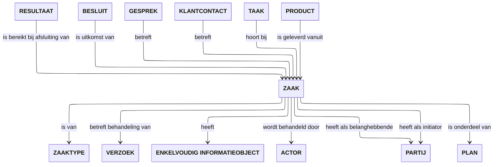

# MijnZaken

MijnZaken brengt de context, voortgang en documenten van overheidsdienstverlening samen. De bouwsteen maakt voor inwoners en ondernemers begrijpelijk wat er speelt, wat de huidige stand van zaken betekent en wat de verwachte vervolgstappen zijn, onafhankelijk van het kanaal of het onderliggende zaaksysteem.

## Doel en gebruikersbehoeften

Een inwoner of ondernemer wil iets voor elkaar krijgen in het dagelijks leven of bedrijf (een vergunning, voorziening, subsidie of melding). MijnZaken ondersteunt het interactiemoment waarin iemand wil weten hoe het met die aanvraag of melding staat, wat er al gebeurd is en wat men kan verwachten.

Statusinformatie vermindert onzekerheid, voorkomt onnodig herhaald contact en geeft duidelijkheid over waar iemand aan toe is.

| Vraag van de gebruiker                                            | Wat MijnZaken ondersteunt                                                          |
| :---------------------------------------------------------------- | :--------------------------------------------------------------------------------- |
| **Welke aanvragen of meldingen lopen er bij de overheid?**        | Overzicht van lopende, afgeronde en conceptdossiers over organisaties heen.        |
| **Waar staat mijn aanvraag en wat betekent dat nu voor mij?**     | De actuele fase vertaald naar begrijpelijke taal en herkenbare mijlpalen.          |
| **Wat is de verwachte volgende stap en wanneer hoor ik iets?**    | Inzicht in de verwachte behandeltermijn of wat de overheid nu doet.                |
| **Wat is er definitief besloten en welke stukken horen daarbij?** | Inzage in formele besluiten, documenten, eerdere contactmomenten en het resultaat. |
| **Moet ik zelf nog iets doen om verder te kunnen?**               | Maakt vervolgstappen en eventuele openstaande acties in de context zichtbaar.      |

## Scope en samenhang

MijnZaken richt zich op de context, status en historie van de behandeling. Andere bouwstenen vullen dit aan:

- **MijnZaken** toont de voortgang, het actuele beeld en formele documenten van een zaak.
- Actiegerichte handelingen (zoals een document aanleveren of leges betalen) worden afgehandeld via [MijnTaken](../mijn-taken/index.md).
- Vragen stellen of digitaal overleg voeren loopt via [MijnGesprekken](../mijn-gesprekken/index.md).
- Formele notificaties en berichten lopen via [MijnBerichten](../mijn-berichten/index.md).
- Interne behandelprocessen, werkverdeling en dossieropbouw blijven binnen de vak- en zaaksystemen van de behandelende organisatie.

### Combineren in de weergave (composability)

In een digitale mijnomgeving worden deze interacties vaak gecombineerd in één scherm: bijvoorbeeld een zaakdetailpagina die tegelijkertijd de actuele status toont (MijnZaken), openstaande acties presenteert (MijnTaken) en de dialoog met de behandelaar weergeeft (MijnGesprekken).

## Bedrijfsobjectenmodel

## Begrippenkader

| Begrip        | Betekenis voor de inwoner of ondernemer                                                                                  |
| :------------ | :----------------------------------------------------------------------------------------------------------------------- |
| **Zaak**      | De samenhangende behandeling van een aanvraag, melding, bezwaar of verzoek.                                              |
| **Zaaktype**  | Het onderwerp of de dienst (bijvoorbeeld _Parkeervergunning_ of _Melding openbare ruimte_), zodat zaken herkenbaar zijn. |
| **Status**    | De actuele stand van de zaak in begrijpelijke taal (geen interne ambtelijke statussen).                                  |
| **Mijlpaal**  | Een herkenbare tussenstap in de tijdlijn (bijvoorbeeld _Aanvraag ontvangen_, _In behandeling_, _Beoordeeld_).            |
| **Besluit**   | De formele beslissing van het bestuursorgaan (met rechtsgevolg).                                                         |
| **Resultaat** | De uiteindelijke uitkomst van een afgeronde zaak (bijvoorbeeld _Toegekend_, _Afgevallen_, _Verleend_).                   |
| **Document**  | Een formeel stuk dat bij de zaak hoort (zoals de aanvraag, een bewijsstuk of de besluitbrief).                           |

## Use cases

### UC-01: Zaken overzien en terugvinden

**Doel:** Overzicht krijgen van lopende en historische zaken en de juiste zaak kunnen selecteren.

MijnZaken ondersteunt dat de gebruiker:

- lopende zaken in één oogopslag ziet en kan onderscheiden op onderwerp en actualiteit;
- afgeronde zaken en uitkomsten uit het verleden kan terugvinden en filteren;
- direct ziet welke organisatie de zaak behandelt en wanneer er voor het laatst iets is gewijzigd;
- duidelijke uitleg krijgt wanneer er geen zaken beschikbaar zijn.

**Resultaat:** De gebruiker heeft overzicht en kan doorklikken naar de context van een specifieke zaak.

### UC-02: Zaakstatus en voortgang volgen

**Doel:** Begrijpen wat de actuele stand van een specifieke zaak is en wat er nu gebeurt.

MijnZaken ondersteunt dat de gebruiker:

- de huidige status en doorlopen mijlpalen begrijpt via een duidelijke tijdlijn;
- inzicht heeft in de verwachte doorlooptijd of de eerstvolgende stap van de overheid;
- ziet of er acties openstaan (met verwijzing naar MijnTaken);
- begrijpt of getoonde termijnen indicatief of formeel zijn;
- duidelijke uitleg krijgt als informatie vertraagd of tijdelijk niet beschikbaar is.

**Resultaat:** De gebruiker heeft duidelijkheid over waar de aanvraag staat en hoeft geen onnodig contact op te nemen voor een statusupdate.

### UC-03: Zaakdocumenten en besluit inzien

**Doel:** Formele stukken, ingediende bijlagen en het definitieve besluit raadplegen.

MijnZaken ondersteunt dat de gebruiker:

- kan nagaan welke documenten zijn ingediend of door de overheid zijn verstrekt;
- het formele besluit en de toelichting daarop kan inzien en downloaden;
- begrijpt wat het resultaat betekent en welke rechtsmiddelen (zoals bezwaar) eventueel openstaan.

**Resultaat:** De gebruiker beschikt over de formele stukken en begrijpt de rechtsgevolgen van het besluit.

## Attenderen

Attenderingen rond MijnZaken informeren de gebruiker proactief over relevante veranderingen in het behandelproces:

- **Belangrijke mijlpaal bereikt:** bijvoorbeeld wanneer een aanvraag formeel in behandeling is genomen.
- **Termijnwijziging of vertraging:** wanneer een verwachte behandeltermijn verschuift, voorzien van toelichting.
- **Besluit beschikbaar:** zodra het formele besluit klaarstaat om in te zien.

Een attendering vermeldt waar het over gaat en verwijst veilig direct naar de betreffende zaakcontext in het portaal.

## Gerelateerd

| Onderdeel           | Verwijzingen                                                                                                                                   |
| :------------------ | :--------------------------------------------------------------------------------------------------------------------------------------------- |
| **Klantscenario's** | [Mijn aanvraag volgen](../../scenarios/index.md#mijn-aanvraag-volgen), [Een reactie begrijpen](../../scenarios/index.md#een-reactie-begrijpen) |
| **Schermprofielen** | [Schermprofielen](../../schermprofielen/index.md)                                                                                              |
