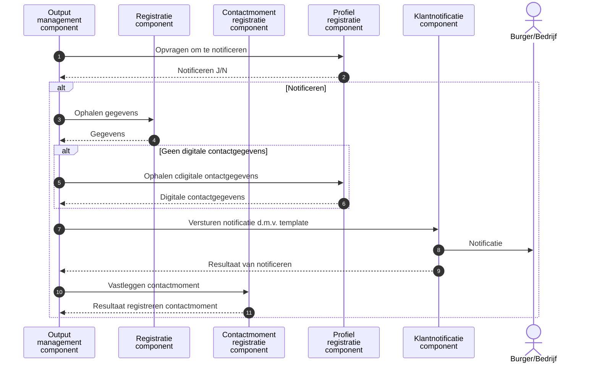

import ModelWeergave from '../../\_model/ModelWeergave';

## Notifcatieservice

Vanuit veel applicaties worden burgers, bedrijven of instellingen geïnformeerd over informatie die de overheid aan verstrekt. Veel van deze applicaties hebben daar een eigen voorziening voor. Ook wordt er een eigen patroon gevolgd of worden bedrijfsregels gevolgd die in de applicatie zijn opgenomen. Dit uit zich in verschillende manieren van informeren naar de burger, bedrijf of instelling.

Om dit te voorkomen is een aantal componenten ontwikkeld die samen in een patroon gebruikt worden om op een uniforme wijze naar burgers, bedrijven en instellingen te kunnen notificeren. Op deze pagina zijn de componenten benoemd en zijn verschillende patronen beschreven.

## Uitgangspunten

Op deze pagina wordt voor ‘informeren’ het begrip ‘notificeren’ gebruikt. Om onderscheid te maken tussen notificeren wat tussen informatiesystemen gebeurt en wat vanuit de overheid naar burgers, bedrijven of instellingen wordt genotificeerd, spreken we in het eerste geval van systeemnotificaties en in het tweede geval van klantnotificaties. In dit patroon wordt ‘klantnotificatie’ bedoeld.

Ook wordt het begrip ‘attenderen’ gebruikt om aan te duiden dat het om niet-formele notificaties gaat in tegenstelling tot formele, bestuurlijke notificaties. Op deze pagina wordt het begrip ‘notificeren’ voor zowel niet-formele als formele notificaties gebruikt.

Daarnaast wordt op deze pagina het begrip ‘klant’ gebruikt. Hiermee bedoelen we de burger, het bedrijf of de instelling waarnaar een notificatie wordt gestuurd.

Getracht is om het beschreven patroon zo generiek mogelijk te houden. In dit patroon wordt gebruik gemaakt van één centraal klantnotificatiecomponent. Binnen één organisatie kan er één centraal klantnotificatiecomponent zijn, maar er kan ook landelijk één centraal klantnotificatiecomponent zijn waar overheidsorganisaties gebruik van maken.

De Wet modernisering elektronisch bestuurlijk verkeer (Wmebv) wordt gevolgd. Als een klant heeft aangegeven geen notificaties wenst te ontvangen, mogen deze ook niet verstuurd worden. Als een klant in een verzoek heeft aangegeven via een specifiek kanaal te willen communiceren en daarmee ook via dat kanaal genotificeerd wil worden, is dat ook meegenomen.

## Positionering

De beschreven componenten op deze pagina zijn referentiecomponenten.

> Een referentiecomponent is “*een type applicatiecomponent dat binnen een referentiearchitectuur benoemd is als elementair bouwblok*". In het geval van de GEMMA gaat het om applicatiecomponenten die functioneren als elementair bouwblok binnen de gemeentelijke informatievoorziening.
>

Referentiecomponenten kunnen als zelfstandige software worden geïmplementeerd, maar kunnen ook onderdeel uitmaken van een samengesteld softwarepakket waarin verschillende referentiecomponenten zijn ondergebracht.

De Klantnotificatiecomponent wordt ingezet voor de communicatie naar de klant. Dit kan via e-mail, SMS of post.

De Klantnotificatiecomponent wordt gepositioneerd in de bedrijfsfunctie Klant- en keteninteractie met daarin de bedrijfsfunctie Informeren. Er wordt geen onderscheid gemaakt in openbaar, vertrouwelijk of persoonlijk informeren. Dat is afhankelijk van de inhoud en niet van het patroon.

De Klantnotificatiecomponent wordt aangestuurd via de Outputmanagementcomponent.

Voor het registreren dat er contact is geweest tussen de overheidsorganisatie en de klant, wordt het resultaat van de notificatie teruggegeven aan de Contactmomentenregistratiecomponent.

Om te weten of er een specifiek kanaal gebruikt moet worden, wordt de registratiecomponent bevraagd waarin de specifieke contactgegevens voor een ingediend verzoek zijn opgeslagen. Als dit niet is opgegeven of de notificatie is niet gerelateerd aan een ingediend verzoek, dan wordt de Klantregistratiecomponent gebruikt.

In dit patroon worden dan ook de volgende vijf componenten gebruikt:

| Component | Toelichting |
| --- | --- |
| Outputmanagementcomponent | Component voor het routeren van de output van processen naar het (de) juiste kana(a)len, waarbij rekening gehouden wordt met de klantvoorkeuren. Elke organisaties heeft vaak een eigen component. |
| Klantnotificatiecomponent | Component dat het verzenden van notificaties (attenderingen) naar burgers, bedrijven of instellingen ondersteunt. Dit kan een lokaal component zijn maar het heeft de voorkeur de landelijke voorziening NotifyNL te gebruiken die door Logius wordt gehost. |
| Contactmomentregistratiecomponent | Component voor opslag en ontsluiting van contactmomentgegevens. |
| Klantregistratiecomponent | Component voor opslag en ontsluiting van profiel- en contactgegevens. Dit kan een lokaal component zijn maar ook de landelijke profielservice die door Logius wordt gehost. |
| Registratiecomponent | Generiek component voor opslag en ontsluiting van gegevens. Dit component is de verzamelnaam voor specifieke registratiecomponenten die tijdens de uitvoering van activiteiten door de medewerker wordt gebruikt. Denk hierbij aan zaakregistratiecomponent, berichtregistratiecomponent, taakregistratiecomponent, et cetera. |

## Patroon

Burgers, bedrijven of instellingen kunnen ervoor kiezen om notificaties te ontvangen. Onderstaand sequence diagram geeft de algemene flow en de samenhang tussen de componenten aan van het notificeren naar een ontvanger. De ontvanger kan een burger, (een specifiek persoon van een) bedrijf of een (specifiek persoon van een) instelling.

| # | Toelichting |
| --- | --- |
| 1 | Burgers, bedrijven en instellingen kunnen aangeven of ze genotificeerd willen worden. Daarmee moet rekening worden gehouden. Vooraf moet daarom gecontroleerd worden of er notificaties gestuurd moeten worden. In deze stap wordt in de Profielregistratiecomponent opgevraagd of notificaties gewenst zijn. |
| 2 | De Profielregistratiecomponent geeft als resultaat een “true” of een “false”. Op basis van dit resultaat worden verdere acties ondernomen (”true”) of niet (”false”). |
| 3 | Er worden gegevens inclusief de specifieke digitale contactgegevens uit de betreffende registratiecomponent gehaald. Als een burger, bedrijf of instelling bij een eerder contactmoment een specifiek digitaal contactvoorkeur heeft aangegeven (bijvoorbeeld bij een aanvraag) dan moeten die digitale contactgegevens gebruikt worden. Vaak worden deze digitale contactgegevens uit een zaakregistratiecomponent gehaald. |
| 4 | De gegevens worden uit de registercomponent teruggegeven. |
| 5 | Als er geen digitale contactgegevens zijn opgenomen, wordt de Profielregistratiecomponent geraadpleegd. Daaruit worden de algemene digitale contactgegevens gehaald. |
| 6 | De algemene digitale contactgegevens worden als resultaat teruggegeven. |
| 7 | Voor het notificeren worden standaard sjablonen gebruikt. Op basis van het communicatiekanaal wordt een specifiek sjabloon gebruikt. De identificatie van dat sjabloon wordt meegestuurd in de aanroep van de API. Daarin worden gegevens uit het register meegestuurd die als waarden ingevuld worden bij de variabelen die in het sjabloon staan. |
| 8 | De notificatie wordt via het juiste kanaal naar de ontvanger gestuurd. |
| 9 | Het resultaat van het versturen van de notificatie wordt teruggegeven. Als het versturen niet is gelukt, valt het opnieuw versturen onder de verantwoordelijkheid van de Klantnotificatiecomponent. Dat is in deze diagram niet uitgewerkt. Het resultaat kan zijn dat de notificatie succesvol is afgeleverd of dat er geen succesvolle notificatie heeft plaatsgevonden. |
| 10 | Zowel een geslaagde als gefaalde notificatie wordt als contactmoment geregistreerd in de Contactmomentregistratiecomponent. Daarbij worden gegevens geregistreerd zoals de tijd waarop het contact plaats vond, het onderwerp, het kanaal, et cetera. |
| 11 | De Contactmomentregistratiecomponent geeft het resultaat terug van het registreren. |
