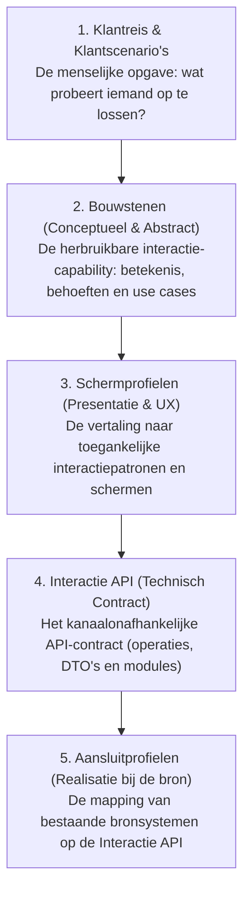

# Opzet en Definition of Done voor Bouwstenen

:::info[Referentiekader voor auteurs]
Dit document beschrijft de standaardstructuur en de kwaliteitseisen (Definition of Done) voor interactiebouwstenen binnen MijnServices. Het dient als inhoudelijk en redactioneel kader om bouwstenen uniform, scherp afgebakend en conceptueel zuiver uit te werken.
:::

## De keten: van abstract naar concreet

Om te borgen dat de verschillende onderdelen van MijnServices elkaar versterken zonder overlap, hanteren we een heldere scheiding van abstract naar concreet:

Binnen deze keten is de **bouwsteen de inhoudelijke en functionele basis**:

- De bouwsteen beschrijft **wat** de interactie inhoudt en **waarom** deze waarde heeft voor de inwoner of ondernemer.
- De bouwsteen is **kanaalonafhankelijk**: de interactie kan vorm krijgen in een mijnomgeving, bij de balie, in het KCC of via een notificatie.
- De bouwsteen is **bronsysteemonafhankelijk**: de betekenis van begrippen staat centraal, niet de database- of zaaksysteemstructuur van een leverancier.
- De bouwstenen zijn **complementair**: elke bouwsteen heeft een strikt afgebakende, eigen verantwoordelijkheid zonder overlap met andere bouwstenen.
- De bouwstenen zijn **combineerbaar in de UX (composability)**: juist doordat bouwstenen complementair zijn en elkaar niet dupliceren, kunnen kanalen meerdere bouwstenen vrij samenvoegen in één scherm, tijdlijn of interactie (zoals de voortgang van een zaak gecombineerd met openstaande acties).

### Bouwstenen als gestandaardiseerde interactiemomenten (Jobs to Be Done)

Een inwoner of ondernemer komt niet naar de overheid om "een zaak te beheren" of "een taak uit te voeren". De werkelijke opgave ligt in het dagelijks leven of ondernemen: een dakkapel plaatsen, verhuizen of een subsidie ontvangen (de _Job to Be Done_).

Een **bouwsteen is daarom geen doel op zich**, maar een **gestandaardiseerd interactiemoment** waarmee een specifieke stap binnen die bredere opgave wordt ondersteund. Eén klantreis of scenario doorloopt in de praktijk meerdere van zulke interactiemomenten:

- De inwoner wil weten hoe het staat met de aanvraag → interactiemoment via **MijnZaken**.
- De overheid vraagt om een ontbrekend bewijsstuk → interactiemoment via **MijnTaken**.
- De leges moeten worden voldaan → interactiemoment via **MijnTaken** (betaling).
- Het besluit wordt gecommuniceerd → interactiemoment via **MijnBerichten** en **MijnZaken**.

De bouwsteen beschrijft de herbruikbare capability die nodig is om zo'n interactiemoment betekenisvol, begrijpelijk en consistent in te vullen.

---

## Wat hoort WEL en NIET in een bouwsteen?

Om verkokering en overlap te voorkomen, hanteren we een strikte afbakening:

| Onderdeel                                                   | Wel in de bouwsteen? | Waar hoort het dan wel?                                     |
| :---------------------------------------------------------- | :------------------: | :---------------------------------------------------------- |
| **Doel en gebruikersbehoeften** _(weten, doen, volgen)_     |        ✅ Ja         | Centraal in de bouwsteen                                    |
| **Scope en afbakening** _(wat wel / wat expliciet niet)_    |        ✅ Ja         | Centraal in de bouwsteen                                    |
| **Begrippenkader & betekenis** _(inwonertaal, statussen)_   |        ✅ Ja         | Centraal in de bouwsteen                                    |
| **Functionele use cases** _(capabilities van de bouwsteen)_ |        ✅ Ja         | Centraal in de bouwsteen                                    |
| **Attenderingsmomenten** _(wanneer en wat signaleren)_      |        ✅ Ja         | Centraal in de bouwsteen                                    |
| **Samenhang & complementariteit met andere bouwstenen**     |        ✅ Ja         | Centraal in de bouwsteen                                    |
| **Concrete schermontwerpen, wireframes en componenten**     |        ❌ Nee        | Onder [Schermprofielen](../../schermprofielen/index.md)     |
| **Technische API-payloads, endpoints en DTO's**             |        ❌ Nee        | Onder [Interactie API](../../interactie-api/index.md)       |
| **Aansluiting op bronsystemen** _(bv. ZGW, OpenVTB)_        |        ❌ Nee        | Onder [Aansluitprofielen](../../aansluitprofielen/index.md) |
| **Interne behandelprocessen van ambtenaren**                |        ❌ Nee        | Buiten scope van MijnServices                               |

---

## Standaardstructuur (Sjabloon voor een bouwsteen)

Elke bouwsteen volgt bij voorkeur deze vaste hoofdstukindeling:

### 1. Inleiding & Doel

- Korte samenvatting van de bouwsteen in 2 à 3 zinnen.
- Welke maatschappelijke opgave of doel in het leven van de burger of ondernemer ondersteunt deze bouwsteen?

### 2. Doel en gebruikersbehoeften

- Wat wil de inwoner of ondernemer in deze interactie:
  - **Weten?** (inzicht, betekenis, rechten, actuele stand van zaken)
  - **Doen?** (handeling verrichten, informatie aanleveren, reageren, betalen)
  - **Volgen?** (voortgang, bevestiging, gemoedsrust)

### 3. Scope en samenhang

- **Wat valt er wél onder:** de kern van deze interactiecapability.
- **Wat valt er expliciet níet onder:** raakvlakken die bij een andere bouwsteen of organisatieproces horen (bv. _"MijnZaken toont de context en status van een zaak, maar een actiegerichte handeling die daaruit voortvloeit wordt afgehandeld via MijnTaken"_).
- **Combineren in de UX (composability):** hoe kanalen deze bouwsteen in één weergave kunnen combineren met andere bouwstenen (bijvoorbeeld een zaakdetailpagina die tegelijk status, openstaande acties en berichten toont).

### 4. Begrippenkader

- Heldere definities van kernbegrippen en functionele toestanden (zoals statussen) in **begrijpelijke taal**.
- Geen interne zaaksysteemtermen of leveranciersjargon; redeneer vanuit wat de gebruiker ervaart.

### 5. Use cases (Capabilities van de bouwsteen)

:::tip[Onderscheid: Klantscenario vs. Use case van een bouwsteen]

- Een **[Klantscenario](../../scenarios/index.md)** beschrijft de menselijke situatie en context van de inwoner of ondernemer binnen een bredere reis (bijvoorbeeld: _"Ontbrekende informatie aanleveren bij een aanvraag"_). Een scenario kan meerdere bouwstenen tegelijk raken.
- Een **Use case van een bouwsteen** beschrijft de **functionele capability** die _deze specifieke bouwsteen_ levert (bijvoorbeeld bij MijnTaken: `UC-TKN-01: Taken raadplegen` en `UC-TKN-02: Taak afhandelen`). Dit is het afgebakende functionele aanbod van de bouwsteen zelf, onafhankelijk van een specifieke casus of kanaalflow.
  :::

- De primaire functionele interacties die de bouwsteen mogelijk maakt (genummerd: `UC-<BOUWSTEENCODE>-<NUMMER>`, bijvoorbeeld `UC-TKN-01`). De vaste bouwsteencodes staan in de README van het documentatiemodel.
- Per use case:
  - **Doel:** Wat stelt deze interactie de gebruiker in staat te bereiken?
  - **Wat de bouwsteen ondersteunt:** Puntenlijst van functionele behoeften en interactiemogelijkheden.
  - **Resultaat:** De functionele toestand na afloop (wat weet of heeft de gebruiker nu?).
  - Indien beschikbaar: verwijzing naar concrete klantscenario's die deze capability toepassen.

### 6. Attenderen

- Bij welke gebeurtenissen binnen deze bouwsteen is attendering van de gebruiker relevant (bijvoorbeeld een nieuw verzoek, gewijzigde status of naderende termijn)?
- Wat moet de attendering functioneel overbrengen en waarnaar moet veilig worden verwezen?
- Let op: attendering is functioneel beschreven, onafhankelijk van het specifieke bezorgkanaal (SMS, e-mail, notificatie).

### 7. Gerelateerd (Optioneel / Redactioneel)

Onder aan een bouwsteen kan een compacte referentietabel worden opgenomen met doorkliklinks naar gerelateerde onderdelen:

:::info[Taak voor site-integratie, niet voor de inhoudelijke auteur]
Het vullen van deze tabel **hoeft niet door de auteur van de bouwsteen te gebeuren**. Auteurs richten zich puur op de inhoudelijke en conceptuele kwaliteit van de bouwsteen.

Het leggen van de doorklikverbindingen naar uitgewerkte klantscenario's, schermprofielen en API-modules is een taak voor **degene die de integrale site samenstelt** (of wordt later door tooling ondersteund). Auteurs mogen deze sectie dus gerust weglaten of leeg laten.
:::

| Onderdeel           | Verwijzingen                                                                     |
| :------------------ | :------------------------------------------------------------------------------- |
| **Klantscenario's** | _(Optioneel)_ Link(s) naar gepubliceerde scenario's die deze bouwsteen toepassen |
| **Schermprofielen** | _(Optioneel)_ Link(s) naar gepubliceerde schermen die deze bouwsteen presenteren |
| **Interactie API**  | _(Optioneel)_ Link naar de gepubliceerde module van de Interactie API            |

---

## Definition of Done (DoD) voor een bouwsteen

Een bouwsteen geldt als **conceptueel gereed** wanneer aan de volgende criteria is voldaan:

### Kwaliteit & Inhoud

- [ ] **Buiten-naar-binnen geformuleerd:** De tekst redeneert vanuit de burger of ondernemer, niet vanuit een gemeentelijke afdeling of wet.
- [ ] **Begrijpelijke taal:** Kernbegrippen en statussen zijn gedefinieerd in duidelijke taal (geen zaaksysteemtermen).
- [ ] **Kanaalonafhankelijk:** De tekst schrijft geen specifieke schermen, knoppen of UI-layouts voor.
- [ ] **Bronsysteemonafhankelijk:** Geen aannames over specifieke leverancierssoftware of interne brondatastructuren.
- [ ] **Scherp afgebakend:** De interactie heeft een duidelijke eigen scope en overlapt niet met andere bouwstenen.
- [ ] **Combineerbaar in de UX:** De interacties kunnen in kanalen vrij worden gecombineerd met andere bouwstenen.
- [ ] **Use cases scherp:** De functionele interacties (bijvoorbeeld `UC-TKN-01`, `UC-TKN-02`) zijn uitgewerkt met doel, ondersteuning en resultaat.
- [ ] **Attenderingsmomenten benoemd:** Er is beschreven wanneer en waarom een attendering nodig is.

### Publicatiestatus & Integratie

- [ ] **Voldoet aan de schrijfwijzer:** Actieve zinnen, beknopt, geen onnodig vakjargon.
- [ ] **Review door werkgroep/community:** Afgestemd met ontwerpers en inhoudelijk deskundigen.
- [ ] **Gereed voor publicatie:** `draft: true` kan worden verwijderd zodra de inhoud formeel is vastgesteld.
- [ ] **Site-integratie (door redactie):** Doorkliklinks naar gerelateerde scenario's, schermen en API worden bij publicatie toegevoegd door de beheerder van de integrale site.
