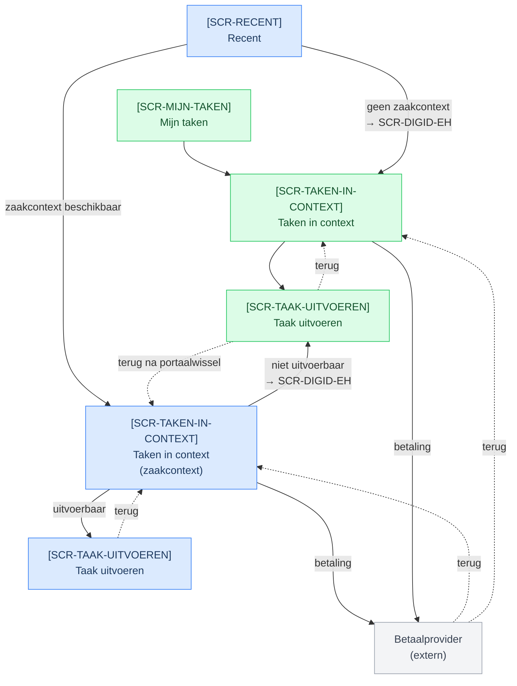
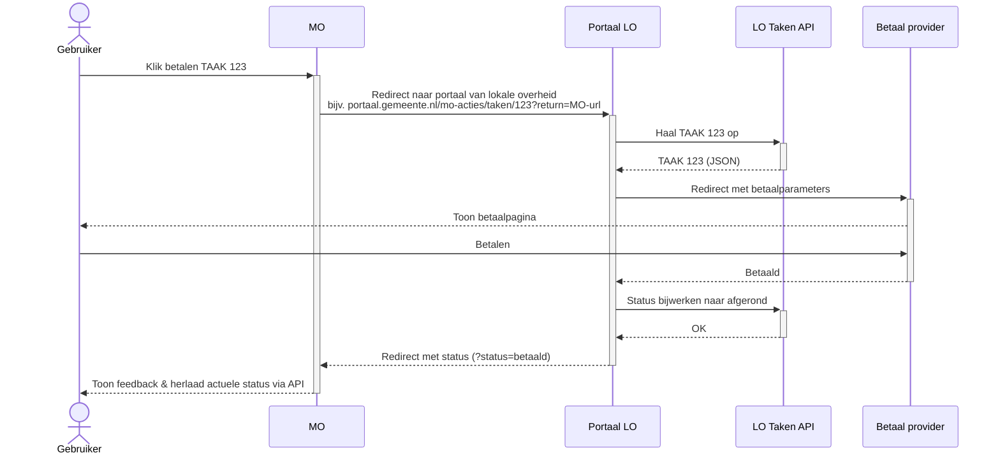
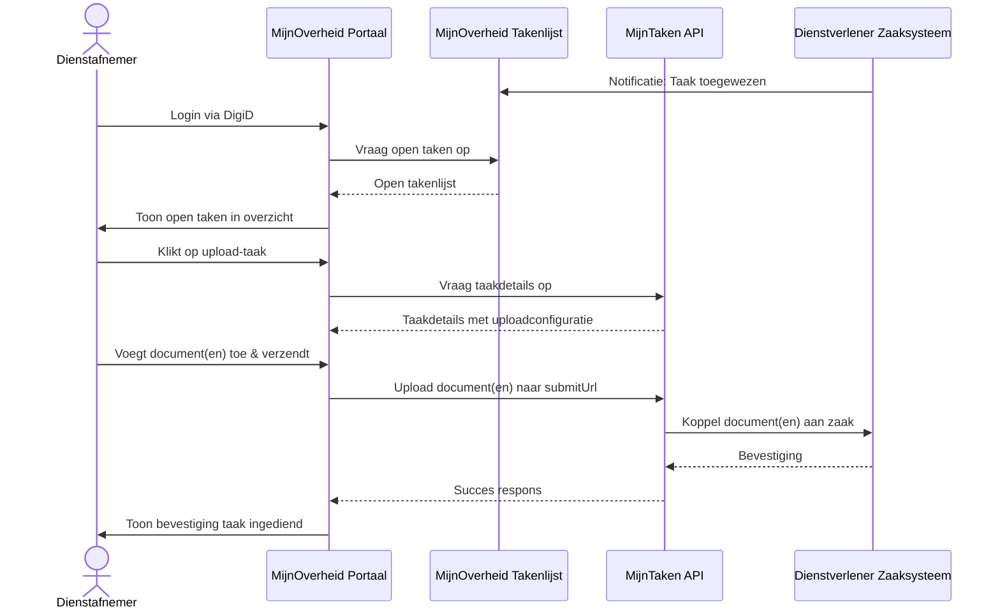

# Portaalwissels

Wanneer een portaal een handeling niet lokaal uitvoert (Implementatieniveau 1 of 2), verlaat de inwoner of ondernemer het portaal om de taak elders te voltooien. We spreken van een **portaalwissel** wanneer deze overgang plaatsvindt over een vertrouwens- en organisatiedomein heen.

## Cross-domein wissel vs. interne applicatie-overdracht

Niet elke doorverwijzing is een portaalwissel:

- **Portaalwissel (Cross-domein):** De overgang tussen twee verschillende organisaties (bijvoorbeeld van MijnOverheid naar de MijnOmgeving van een gemeente of uitvoerder). Omdat de doelorgaan geen toegang heeft tot de sessie van het vertrekkende portaal, is **herauthenticatie** vereist (zoals DigiD Eenvoudige Herauthenticatie).
- **Interne applicatie-overdracht (Binnen één domein):** Een portaal leidt de gebruiker door naar een specialistische deelfunctie binnen dezelfde organisatie (zoals een parkeerapplicatie of formulierenserver). Dit wordt intern afgehandeld via SSO, gedeelde cookies of een beveiligde token-URL; er is geen nieuwe DigiD-stap nodig.

---

## Sessieoverdracht en DigiD Herauthenticatie

Bij een cross-domein portaalwissel landt de gebruiker via een deeplink op de omgeving van de aanbieder. Om te borgen dat de gebruiker direct in de juiste context verder kan zonder opnieuw volledig in te loggen, wordt [DigiD Eenvoudige Herauthenticatie](../schermprofielen/uitvoering/digid-eenvoudige-herauthenticatie.md) (`SCR-DIGID-EH`) ingezet.

---

## Navigatieflow langs portalen

Onderstaand diagram toont de navigatieflow langs de [schermprofielen](../schermprofielen/index.md) per startpunt en taaktype. **Blauw** is het pad voor MijnOverheid, **groen** voor de lokale MijnOmgeving. De betaalprovider (grijs) is extern en bereikbaar vanuit beide portalen.

---

## Technische uitvoeringsflows

### 1. Betaling via externe provider en terugkeer

Bij betaling leidt het portaal de gebruiker door naar de betaalprovider. Na afronding keert de gebruiker terug met een statusparameter. Het portaal verifieert vervolgens de actuele status via de Interactie API:

### 2. Documenten aanleveren via MijnOverheid

Wanneer een portaal documentupload lokaal ondersteunt (Niveau 3), worden documenten direct ingediend bij het endpoint van de provider:

---

## Terugkeer en transiente statusfeedback

Wanneer de gebruiker na een handeling terugkeert naar het oorspronkelijke portaal (via de `returnUrl`), kan de ontvangende partij een statusparameter meegeven (bijvoorbeeld `?status=betaald`).

- **Transiente UX-feedback:** Het portaal mag deze parameter gebruiken om de gebruiker direct feedback te geven (bijvoorbeeld een melding: _"Uw betaling is verwerkt"_).
- **Statusverificatie via API:** De parameter is geen juridisch of technisch bewijs van afronding. Het portaal herlaadt de taak via de Interactie API (`GET /taken/{uuid}`) om de actuele, door de bron bevestigde toestand te tonen.
