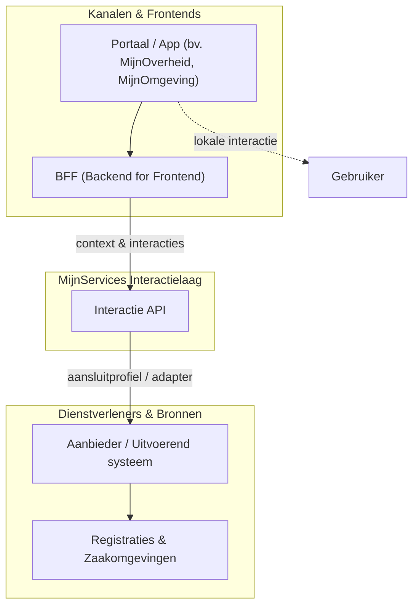
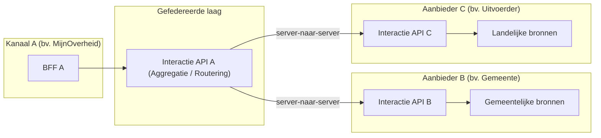

# Positionering

De Interactie API vormt de gestandaardiseerde interactielaag tussen gebruikerskanalen (zoals portalen en apps) en de uitvoerende overheid. In plaats van systemen of registers direct aan te sluiten op een front-end, standaardiseert de Interactie API op wat inwoners en ondernemers willen weten, doen of volgen: redenerend van **buiten naar binnen**.

## Rolverdeling in het landschap

De Interactie API wordt primair aangesproken door **BFF's (Backend for Frontend)** van portalen en apps. Dit bewaakt een zuivere scheiding van verantwoordelijkheden:

Deze scheiding waarborgt de [uitgangspunten van de Interactie API](./index.md#uitgangspunten-voor-de-rolverdeling): een interactiecontract (geen beheerregister), uitvoering bij de bron, context als primair concept en een recursief samenstelbare werking.

---

## Geschakelde en gefedereerde werking

In een landschap met meerdere overheden en portalen kan de Interactie API op verschillende niveaus worden ingezet. De interface is recursief toepasbaar en hoeft niet altijd direct op een bronsysteem aan te sluiten: **een Interactie API kan zelf als bron fungeren voor een bovenliggende Interactie API**.

### Hoe federatie werkt

- **Agnostisch voor onderliggende techniek:** Voor BFF A maakt het niet uit of API A direct data ophaalt of doorvraagt naar API B en C. Het contract blijft identiek.
- **Klantidentificatie in context:** In een geschakelde keten moet de federatieve laag weten namens welke klant een verzoek loopt (`klantId`) en de autorisatie context- en partijspecifiek kunnen doorgeleiden.
- **Samengesteld beeld:** De bovenliggende API kan gegevens uit meerdere onderliggende Interactie API's aggregeren tot één antwoord voor het portaal, zonder dat het portaal met tientallen bronnen afzonderlijk hoeft te koppelen.
